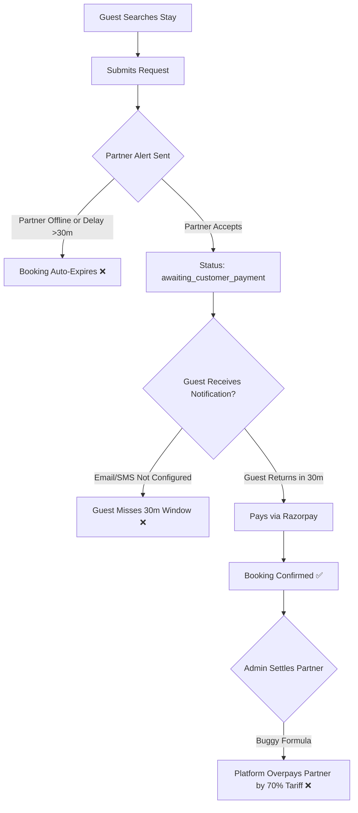

# Vrindavan Sarthi — Executive Audit Summary & Platform Assessment

**Document ID:** `VRS-AUDIT-00-EXEC`  
**Audit Date:** October 17, 2026  
**Auditor:** Senior Software Architect, Full-Stack Engineer, QA Automation Engineer, Security Auditor & OTA Consultant  
**Project:** Vrindavan Sarthi  
**Production Domains:**  
- Primary Production Domain: [https://www.vrindavansarthi.in/](https://www.vrindavansarthi.in/)  
- Secondary Production Domain: [https://www.vrindavansarthi.com/](https://www.vrindavansarthi.com/)  
- Backend API Host: `https://vrindavan-sarthi-gla3.onrender.com`  

---

## 1. Executive Status & Booking-Readiness Verdict

### Platform Status: **CONDITIONAL GO / NOT READY FOR SCALED COMMERCIAL ADVERTISING**

Vrindavan Sarthi has established a robust, thoughtfully engineered full-stack foundation. It features clean architecture, strong defensive NoSQL sanitization, atomic inventory reservation locking via unique MongoDB indexes, durable BullMQ queues for webhooks/refunds/notifications, and dedicated admin and partner portals.

However, **the platform is NOT commercially ready for full customer acquisition and multi-hotel marketing campaigns** due to three critical architectural and operational blockers:

1. **Two-Step "Request-Only" Booking UX Disconnect (P1 - High):**  
   Every lodging stay (Hotel or Dharamshala) forces the guest through a request flow (`pending_property_confirmation`). The guest cannot pay immediately. The partner must manually log in and accept within 30 minutes, after which the guest is expected to return to `/bookings/:id` within 30 minutes to pay. For standard commercial hotels, modern guests expect instant booking confirmation. If partners do not accept within 30 minutes, bookings expire automatically.
2. **Critical Partner Payout Settlement Math Flaw (P0 - Financial Risk):**  
   In `backend/routes/partner.routes.js`, the partner ledger calculates net payable remittance as `grossForHotel - commission - gatewayCharges` without deducting `balanceAtProperty` (the 70% cash balance already collected directly by the hotel from the guest for `advance_30` bookings). If an admin initiates settlement based on this ledger, the platform would overpay the hotel by 70% of the room tariff, causing severe financial leakage.
3. **Dual-Domain Canonical Discrepancy & SEO Deadlocks (P1 - High):**  
   Both `vrindavansarthi.in` and `vrindavansarthi.com` serve HTTP 200 responses directly on Vercel without 301 redirection of `.com` to `.in`. Furthermore, the HTML and dynamic SEO scripts define canonical tags as `https://vrindavansarthi.in/` (apex), but Vercel redirects apex to `https://www.vrindavansarthi.in/` (www) with HTTP 308. In addition, production `index.html` still contains placeholder Google Search Console and Bing verification tokens (`GOOGLE_SEARCH_CONSOLE_VERIFICATION_TOKEN`).

---

## 2. Key Business & Technical Metrics (Live Production Data)

| Metric | Verified Value | Evidence Source | Notes |
| :--- | :--- | :--- | :--- |
| **Active Listed Properties** | 13 | Production API `/api/public-stats` | 8 Hotels, 5 Dharamshalas |
| **Active Tour Packages** | 7 | Production API `/api/public-stats` | Braj Darshan, Govardhan Parikrama, etc. |
| **Paid User Bookings** | 3 | Production API `/api/public-stats` | Early production pilot transactions |
| **Frontend Framework** | React 18.3.1 + Vite 5.4.19 | `frontend/package.json` | TypeScript 5.8, Tailwind CSS, shadcn/ui |
| **Backend Framework** | Node.js + Express 4.21.0 | `backend/package.json` | CommonJS, Mongoose 8.7, BullMQ 6.3 |
| **Database** | MongoDB 7 (Atlas) | Live `/api/readiness` | Mongoose ODM with custom indexes |
| **Job Queue / Redis** | Redis 7 + BullMQ | Live `/api/readiness` | Configured; optional in API, required in worker |
| **Payment Gateway** | Razorpay | `backend/utils/razorpay.js` | Webhook verification, signature auth, capture |
| **Automated Test Pass Rate** | **142 Passed / 1 Failed** | Local execution against test suite | 1 failure is an outdated regex assertion |
| **TypeScript Typecheck** | **0 Errors (Clean)** | `npx tsc --noEmit` | Clean type compilation across all pages |

---

## 3. Top 5 Revenue & Customer Blockers

1. **High Booking Abandonment Risk from Two-Step Confirmation:**  
   Unlike OTAs (MakeMyTrip, Booking.com), guests cannot complete an instant booking. If the property manager is busy or asleep, the request expires after 30 minutes.
2. **Notification Channel Vulnerability:**  
   If neither SMTP nor Resend is fully configured in production, or if native Android FCM push tokens are unattached for a partner, the partner never gets the alarm, ensuring 100% expiry rate for that property.
3. **Cabs and Tours Bypassing Automated Checkout:**  
   Cab and Tour detail pages do not support direct web checkout; they redirect to WhatsApp or phone calls. While practical for high-touch local operations, it prevents direct conversion tracking and automated revenue capture.
4. **Partner Payout Ledger Discrepancy:**  
   Admins cannot safely use the automated payout settlement button on `/admin/partner-payouts` until the formula is corrected to reflect net cash collected at the desk.
5. **Duplicate Domain SEO Dilution:**  
   Google indexes both `.in` and `.com`, while all sitemap links return 308 redirects, hindering search rankings for high-intent keywords like "dharamshala booking in Vrindavan".

---

## 4. Key Decisions Requiring Owner Approval

1. **Instant Booking vs. Property-Request Flow for Commercial Hotels:**  
   Should verified commercial hotels have "Instant Book" (pay upfront, immediate room lock), reserving the "Request First" flow strictly for Dharamshalas and homestays?
2. **Canonical Brand Domain Confirmation:**  
   Confirm whether `https://www.vrindavansarthi.in/` is the official single canonical domain, authorizing an immediate 301 edge redirect from `vrindavansarthi.com` to `www.vrindavansarthi.in`.
3. **Online vs. Desk Booking for Cabs and Tours:**  
   Determine whether Cab and Tour bookings should remain assisted WhatsApp/phone desk inquiries or be upgraded to full self-serve Razorpay booking flows.
4. **Partner Commission Basis Approval:**  
   Formally approve the commission policy: is the 10% platform commission calculated strictly on the room base price or room price + GST? Confirm that gateway fees (2%) are deducted from the partner's gross payout.
5. **Notification and Infrastructure Sizing:**  
   Approve active production configuration of Resend/SMTP and managed Redis for the background worker to ensure continuous booking expiration sweeps and webhook reconciliations.

---

## 5. Audit Scope & Verification Statement

This audit was conducted strictly using **non-destructive, read-only inspection methods**. No application source files were altered, no database migrations or seed scripts were executed, no real bookings or charges were initiated, and no environment secrets were exposed. All test and check scripts were isolated to temporary artifacts and local test runners.
