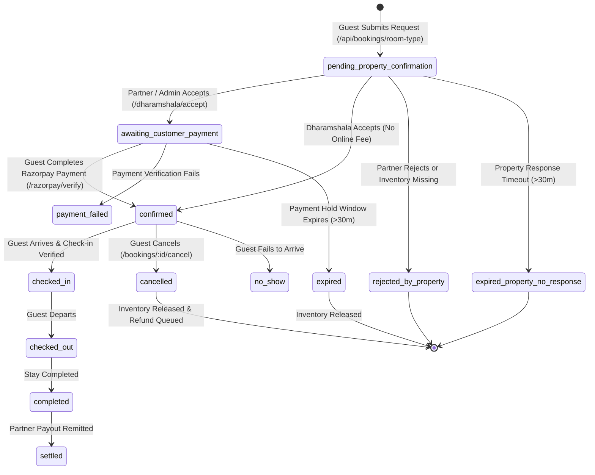

# Vrindavan Sarthi — Booking Engine & Inventory Audit

**Document ID:** `VRS-AUDIT-03-BOOKING`  
**Audit Date:** October 17, 2026  
**Auditor:** Senior Software Architect, QA Automation Engineer & OTA Consultant  

---

## 1. End-to-End Booking State Machine

The core reservation lifecycle is managed by `backend/utils/reservationLifecycle.js` and `backend/utils/dharamshalaLifecycle.js`. Every lodging stay (Hotels, Dharamshalas, Homestays, Guest Houses) transitions through a strictly validated state graph:



### Valid Transition Matrix (`BOOKING_TRANSITIONS`):
- `pending_property_confirmation` $\rightarrow$ `['awaiting_customer_payment', 'confirmed', 'rejected_by_property', 'expired_property_no_response', 'cancelled']`
- `awaiting_customer_payment` $\rightarrow$ `['confirmed', 'payment_failed', 'expired', 'cancelled']`
- `confirmed` $\rightarrow$ `['checked_in', 'cancelled', 'no_show']`
- `checked_in` $\rightarrow$ `['checked_out', 'completed']`
- `checked_out` $\rightarrow$ `['completed']`
- `completed` $\rightarrow$ `['settled']`
- Terminal States (Immutable): `['cancelled', 'expired', 'payment_failed', 'rejected_by_property', 'expired_property_no_response', 'settled']`

---

## 2. Inventory Architecture & Atomic Double-Booking Prevention

### The Physical Inventory Hierarchy:
```text
Partner (User with role='partner')
  └── Hotel (1 Property per Partner)
       └── RoomType (e.g. "Deluxe AC Room", maxAdults: 2, pricePerNight: 1500)
            └── RoomUnit (Physical Rooms: "101", "102", "103", ...)
                 ├── RoomUnitBookingDay (Date-wise reservation lock)
                 └── RoomUnitBlock (Manual maintenance/offline block)
```

### Double-Booking Prevention Mechanism:
1. **Compound Unique Index:**  
   In `backend/models/RoomUnitBookingDay.js`:
   ```javascript
   roomUnitBookingDaySchema.index({ roomUnitId: 1, date: 1 }, { unique: true });
   ```
   MongoDB physically guarantees that a specific room unit cannot be reserved more than once on any given calendar date.
2. **Lock Acquisition during Acceptance:**  
   When a partner accepts a booking request via `/api/bookings/:id/dharamshala/accept`, `tryReserveRoomUnitsForBooking` iterates candidate physical room units and attempts an atomic `insertMany` of `RoomUnitBookingDay` records for each date in `[checkIn, checkOut)`.
3. **Collision Handling:**  
   If a concurrent booking attempts to lock the same room on overlapping dates, MongoDB throws a `11000 Duplicate Key Error`. The algorithm catches this error, immediately rolls back any partial inserts for that booking, and tests the next candidate room unit. If no combination satisfies the required room quantity, the acceptance fails gracefully and moves the booking to `rejected_by_property` with reason `inventory_unavailable_at_acceptance`.
4. **Verification via Automated Test Suite:**  
   This atomic concurrency behavior is verified in `backend/tests/phase2-reservation.test.js` (`concurrent room-night lock acquisition allows only one booking for one physical room date`), which passes consistently.

---

## 3. Date, Timezone & Capacity Validation

1. **Date Parsing:**  
   `backend/utils/date.js` implements `parseDateOnlyToUTC(dateString)`, parsing input strings (e.g., `2026-10-25`) to pure UTC midnight (`2026-10-25T00:00:00.000Z`). This eliminates local server timezone drift between IST (+05:30) and UTC.
2. **Date Order Enforced:**  
   In `backend/routes/booking.routes.js:391`:
   ```javascript
   if (!isValidDate(checkIn) || !isValidDate(checkOut) || checkIn >= checkOut) {
     return res.status(400).json({ success: false, message: 'Valid checkIn and checkOut are required' });
   }
   ```
   Same-day check-in/out and reverse dates are rejected immediately.
3. **Occupancy & Room Quantity Clamping:**  
   - Room quantity is clamped between `1` and `20`.
   - Max adults is validated as `roomQuantity * roomType.maxAdults`.
   - If `totalAdults > maxAdultsForBooking`, the booking is rejected with an actionable error.
   - Pet policies are validated against both `hotel.petsAllowed` and `roomType.petsAllowed`.

---

## 4. Temporary Holds, Timeouts and Auto-Expiration

The system features two independent countdown timers:

| Timer Name | Field Name | Default Duration | Trigger Event | Consequence of Expiry |
| :--- | :--- | :--- | :--- | :--- |
| **Partner Response Timeout** | `requestExpiresAt` | 30 minutes | Booking submission by customer | If property manager does not accept within 30m, status transitions to `expired_property_no_response`. |
| **Payment Hold Timeout** | `paymentHoldExpiresAt` | 30 minutes | Partner accepts booking request | Physical rooms are locked. Customer has 30m to pay online. If unpaid, status transitions to `expired` and room locks are deleted. |

### Sweep and Expiration Execution:
- Background worker `node worker.js` executes `sweepBookingExpiration()` periodically via BullMQ scheduler `phase4.4:booking-expire-pending-sweep`.
- For resilience when Redis is absent, `backend/routes/booking.routes.js` also triggers on-demand expiration during search and detail queries.
- When a booking expires, `releaseBookingInventory` deletes all associated `RoomUnitBookingDay` records and triggers waitlist processing (`processRoomTypeWaitlist`).

---

## 5. Duplicate Submissions, Idempotency & Webhook Delivery

1. **Client Request Idempotency:**  
   `createRequestIdempotencyKey` generates a SHA-256 digest of `userId|hotelId|roomTypeId|checkIn|checkOut|roomQuantity|adults|children`. If a user double-clicks "Submit Request", the existing booking is detected and returned with HTTP 200 and `idempotent: true`, preventing duplicate booking records.
2. **Razorpay Webhook Idempotency:**  
   Inbound payment webhooks are persisted to MongoDB model `WebhookEvent` with unique compound index `provider + eventId`. If Razorpay retries webhook delivery, the duplicate event ID is recognized, returning HTTP 200 without duplicate execution.

---

## 6. Critical Operational Flaws & Disconnected Steps

### Blocker 1: Instant Booking Missing for Commercial Hotels
Currently, **every hotel room booking requires manual partner acceptance**. In the modern hospitality market:
- Commercial travelers expecting instant confirmation will abandon the platform upon seeing *"Request submitted. The property will confirm availability before payment."*
- If the hotel desk clerk is away or asleep, the request expires in 30 minutes, resulting in zero conversion.

### Blocker 2: Partner Notification Delivery Dependent on External Setup
Because partner acceptance is mandatory before payment, the booking flow depends entirely on the partner receiving an instant alarm.
- If the partner has not installed the Android companion app or granted push notifications, they rely on SMS/Email.
- If production SMS/Email is unconfigured or blocked, the partner never knows a request exists.

### Blocker 3: Inconsistent Customer Recovery for Hotel Rejections
In `frontend/src/pages/user/BookingDetail.tsx:819-832`, if a Dharamshala booking is rejected or expires, the UI displays a helpful banner: *"Find Another Dharamshala"*. However, if a regular HOTEL booking is rejected or expires, the condition `isDharamshalaBooking` evaluates false, leaving the customer with a blank status card without guidance on alternative hotels.
