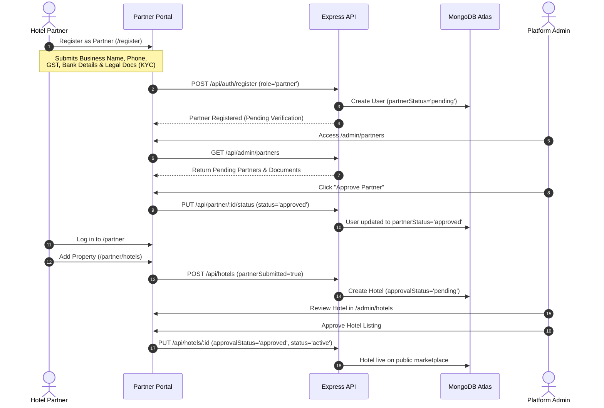

# Vrindavan Sarthi — Admin & Partner Operations Audit

**Document ID:** `VRS-AUDIT-06-OPS`  
**Audit Date:** October 17, 2026  
**Auditor:** Senior Software Architect & Hospitality Operations Consultant  

---

## 1. Role & Permission Architecture

The platform defines three distinct user roles in `backend/models/User.js`:

```text
┌────────────────────────────────────────────────────────────────────────┐
│                          USER ROLES IN SYSTEM                          │
├───────────────────┬────────────────────────────────────────────────────┤
│ 1. User (Guest)   │ Browses stays/cabs/tours, submits requests,        │
│                   │ pays online, manages personal bookings & profile.  │
├───────────────────┼────────────────────────────────────────────────────┤
│ 2. Partner        │ Hotel or Dharamshala owner/manager. Manages their  │
│                   │ property, rooms, inventory calendar, and requests. │
├───────────────────┼────────────────────────────────────────────────────┤
│ 3. Admin          │ Platform superuser. Full operational oversight,   │
│                   │ partner approvals, payouts, settings & analytics.  │
└───────────────────┴────────────────────────────────────────────────────┘
```

> [!NOTE]  
> **Property Manager Role Clarification:**  
> The codebase and database do not contain a distinct `"property_manager"` role. Instead, the **Partner** role encompasses all property management functions. Each partner account is bounded to exactly one registered `Hotel` entity (`backend/routes/partner.routes.js:52`).

---

## 2. Partner Onboarding & Property Lifecycle Workflow



### Verification Points:
1. **KYC Document Ingestion:** The partner registration form accepts up to 10 verification documents (Aadhar, GST, Property Registry, Business License, PAN). Documents are safely stored and displayed in `/admin/partners` with direct preview buttons.
2. **One-Partner-One-Hotel Enforcement:** `backend/routes/partner.routes.js` explicitly verifies that a partner does not already own an existing `Hotel` before allowing property creation, preventing inventory fragmentation.
3. **Approval Gating:** Unapproved partners are barred from modifying inventory or accepting guest bookings until an admin grants formal approval.

---

## 3. Partner Operational Workflows

### A. Room Inventory & Availability Management
- **Room Types (`/partner/inventory`):** Partners can add room categories (e.g., "Executive AC Room", "Family Suite"), defining base tariffs, max adults, max children, and amenities.
- **Physical Room Units (`/partner/inventory`):** Partners define physical room numbers (e.g., Room 101, 102). These units back the atomic day-level locking system.
- **Availability Calendar (`/partner/availability`):** Interactive monthly calendar displays booked dates (locked by `RoomUnitBookingDay`) and allows one-click creation or release of maintenance/offline blocks (`RoomUnitBlock`).

### B. Booking Request Processing (Accept / Reject)
- **Reviewing Inbound Requests (`/partner/bookings`):** When a guest submits a lodging request, it appears under "Pending Requests" with guest name, dates, adults, children, and vehicle details.
- **Acceptance Action:**
  - For Dharamshalas: Partner chooses payment mode: `pay_at_dharamshala` (pilgrim pays only platform service fee online) or `full_online`.
  - For Hotels: Acceptance immediately locks available physical room units and sets a 30-minute customer payment hold (`paymentHoldExpiresAt`).
- **Rejection Action:** Partner provides a rejection reason (e.g., "Offline walk-in full", "Under renovation"). Status transitions to `rejected_by_property`.

### C. Stay Execution & Guest Check-In
- **Check-In Verification:** When guests arrive at the hotel desk, the partner marks the booking `checked_in`. The system records `checkedInAt`, `checkedInByPartnerId`, and `checkedInByPartnerName`.
- **Check-Out:** At departure, the partner marks `checked_out`, which triggers eligibility for partner payout settlement.

---

## 4. Administrator Operations & Platform Governance

### A. Operations Dashboard (`/admin/operations` & `/admin/analytics`)
- **System Metrics:** Displays platform revenue, total bookings, registered pilgrims, active properties, and real-time listing counts.
- **Payment Reconciliation Monitor (`/admin/operations`):** Displays uncaptured payments, orphaned orders, currency mismatches, and allows manual retry or resolution.
- **Refund Monitor:** Displays pending or failed customer refunds with direct retry actions.

### B. Rate Engine & Seasonal Tariffs (`/admin/inventory`)
- Admins have master override capability across all properties.
- In `backend/routes/rate.routes.js`, admins and partners can configure `RatePlan` (EP, CP, MAP meal plans) and `RateCalendar` for seasonal surge pricing (e.g., Janmashtami, Radhashtami, Kartik Purnima) with minimum-stay and closed-to-arrival (CTA) restrictions.

### C. Channel Manager Dashboard (`/admin/channel-manager`)
- Shows active channel connections, property mappings, and incoming sync event logs.
- Currently maintains eZee PMS in safely disabled state pending commercial contracts.

---

## 5. Operational Deficiencies & Workflow Gaps

1. **Absence of Offline / Walk-in Booking Ingestion in Partner Dashboard:**  
   If a walk-in guest arrives at the hotel desk without using Vrindavan Sarthi, the partner cannot create an offline reservation directly in the system. They must manually block each room date via "Maintenance Block" on the calendar, which does not record guest PII or accounting data.
2. **Missing Dispute / Resolution Interface:**  
   There is no dedicated dispute management screen for customer complaints (e.g., room dirty upon arrival, partner demanded extra money). Admins must handle disputes via manual phone/WhatsApp contact.
3. **No Granular Sub-User Permissions for Hotel Staff:**  
   Because there is only one "Partner" account per hotel, the hotel owner must share their master partner credentials with front-desk receptionists. A dedicated "Front Desk" sub-role with restricted financial visibility would improve operational security.
