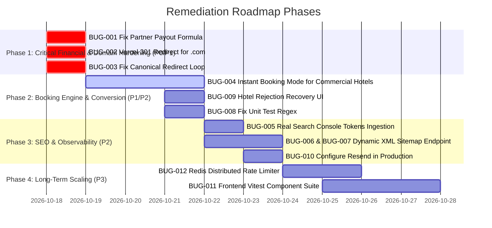

# Vrindavan Sarthi — Prioritized Remediation Roadmap

**Document ID:** `VRS-AUDIT-10-ROADMAP`  
**Audit Date:** October 17, 2026  
**Auditor:** Senior Software Architect, QA Automation Engineer & DevOps Lead  

---

## 1. Priority Classification Framework

- **P0 — Critical:** Active security exposure, payment/financial integrity failure, serious data corruption, or immediate production containment required.
- **P1 — High:** Booking completion blocked, incorrect charges, overbooking risk, authorization failure, or major workflow failure.
- **P2 — Medium:** Significant usability, SEO, operational, integration, or performance weakness.
- **P3 — Low:** Cosmetic issues, test coverage expansion, and non-critical optimizations.

---

## 2. Master Implementation Roadmap

---

## 3. Detailed Fix Specifications & Acceptance Criteria

### Phase 1: Immediate Financial & Domain Containment (Within 24–48 Hours)

#### Task 1.1: Fix Partner Payout Remittance Formula (`BUG-001` — P0)
- **Target Files:** `backend/routes/partner.routes.js:517-536` and `partner.routes.js:601-620`.
- **Root Cause:** Mongo aggregation in `netPayableRemittanceBalance` computes `grossForHotel - commission - gatewayCharges` without subtracting `$balanceAmount` (the 70% cash balance collected at check-in by the hotel).
- **Implementation:**
  Update aggregation expressions to:
  $$\text{netRemittance} = \max(0, \text{grossForHotel} - \text{balanceAmount} - \text{deductedPlatformCommission} - \text{paymentGatewayCharges})$$
- **Estimated Effort:** 2–4 hours (labeled estimate).
- **Dependencies:** None.
- **Acceptance Criteria:**
  1. For an `advance_30` booking of ₹1,000 base + ₹120 GST, where the customer pays ₹336 online and ₹784 at the property, the calculated platform remittance to the partner MUST equal ₹200 (platform retains ₹100 commission + ₹20 gateway charge from the ₹336 received).
  2. For a `full_100` booking, remittance remains `grossForHotel - commission - gatewayFee`.
  3. Regression test `TM-032` passes with zero financial drift.

---

#### Task 1.2: Establish 301 Permanent Redirect for `.com` (`BUG-002` — P1)
- **Target Environment:** Vercel Project Dashboard (Domain Management).
- **Root Cause:** Both `.in` and `.com` are configured as production primary domains, serving duplicate SPAs.
- **Implementation:**
  In Vercel Domain Configuration, set `vrindavansarthi.com` and `www.vrindavansarthi.com` to redirect permanently (301) to `https://www.vrindavansarthi.in`.
- **Estimated Effort:** 30 minutes (labeled estimate).
- **Dependencies:** Vercel Team Admin Access.
- **Acceptance Criteria:**
  1. `curl -ILs https://www.vrindavansarthi.com/` returns `HTTP/1.1 301 Moved Permanently` with `Location: https://www.vrindavansarthi.in/`.
  2. All subpaths (e.g. `/hotels`, `/tours`) preserve route paths across the redirect.

---

#### Task 1.3: Eliminate Canonical Redirect Loop (`BUG-003` — P1)
- **Target Files:** `frontend/src/lib/seo.ts:1` and `frontend/index.html:23`.
- **Root Cause:** Code defines `SITE_ORIGIN = 'https://vrindavansarthi.in'` (apex), while Vercel redirects apex to `www`.
- **Implementation:**
  Update `SITE_ORIGIN` to `https://www.vrindavansarthi.in` and update `index.html` static canonical link tag to `https://www.vrindavansarthi.in/`.
- **Estimated Effort:** 1 hour (labeled estimate).
- **Dependencies:** None.
- **Acceptance Criteria:**
  1. Canonical link tag on homepage reads `<link rel="canonical" href="https://www.vrindavansarthi.in/" />`.
  2. Requesting the canonical URL returns `HTTP 200 OK` directly without redirects.

---

### Phase 2: Booking Engine Conversion Optimization (Days 3–5)

#### Task 2.1: Enable Instant Booking for Commercial Hotels (`BUG-004` — P1)
- **Target Files:** `backend/routes/booking.routes.js:450-520` and `frontend/src/pages/RoomTypeDetail.tsx:405-440`.
- **Description:** Allow approved commercial hotels to accept instant online payment without requiring manual 30-minute partner acceptance, while preserving the request-first flow for Dharamshalas and homestays.
- **Implementation:**
  1. Check `hotel.propertyType`. If `hotel` and partner has enabled `instantBookingEnabled: true`:
     - Atomically lock physical rooms via `tryReserveRoomUnitsForBooking`.
     - Set status directly to `awaiting_customer_payment` with a 15-minute hold.
     - Immediately invoke Razorpay checkout on the frontend.
  2. If `dharamshala`, continue through `createDharamshalaRequest` (request-first).
- **Estimated Effort:** 12–16 hours (labeled estimate).
- **Dependencies:** Platform Owner Approval on Commercial Policy.
- **Acceptance Criteria:**
  1. Customers selecting a commercial hotel can click "Pay & Confirm" and complete payment immediately.
  2. Room inventory is locked during the checkout session.
  3. Dharamshala requests remain non-instant and require property review.

---

#### Task 2.2: Add Customer Recovery UI for Hotel Rejections (`BUG-009` — P2)
- **Target File:** `frontend/src/pages/user/BookingDetail.tsx:198-202`.
- **Implementation:** Expand condition `canFindAnotherDharamshala` to handle `propertyType === 'hotel'` with a banner and CTA button *"Find Another Hotel"* linking to `/hotels`.
- **Estimated Effort:** 1–2 hours (labeled estimate).
- **Acceptance Criteria:** Rejected or expired hotel bookings display a helpful message and direct link back to hotel search.

---

#### Task 2.3: Correct Assertion Regex in Test Suite (`BUG-008` — P2)
- **Target File:** `backend/tests/dharamshala-booking-flow.test.js:221-226`.
- **Implementation:** Update regex from `/authorize\('partner'\)/` to `/authorize\('(admin', 'partner'|'partner', 'admin')\)/`.
- **Estimated Effort:** 30 minutes (labeled estimate).
- **Acceptance Criteria:** `node --test tests/dharamshala-booking-flow.test.js` passes with 100% success rate.

---

### Phase 3: SEO, Indexability & Infrastructure (Days 6–8)

#### Task 3.1: Ingest Real Google & Bing Verification Tokens (`BUG-005` — P2)
- **Target File:** `frontend/index.html:17-18`.
- **Estimated Effort:** 30 minutes.
- **Dependencies:** Verification codes provided by domain owner.

#### Task 3.2: Implement Dynamic Backend XML Sitemap (`BUG-006`, `BUG-007` — P2)
- **Target Files:** `backend/routes/seo.routes.js` and `frontend/vercel.json`.
- **Implementation:**
  Create endpoint `GET /api/seo/sitemap.xml` that queries MongoDB for all active, approved hotels, room types, and tours, returning valid XML with `https://www.vrindavansarthi.in/hotels/:id`, etc. Rewrite `/sitemap.xml` in `vercel.json` to this endpoint.
- **Estimated Effort:** 4–6 hours (labeled estimate).
- **Acceptance Criteria:** `curl https://www.vrindavansarthi.in/sitemap.xml` lists all active properties with 200 OK URLs.

#### Task 3.3: Configure Production Transactional Email (`BUG-010` — P2)
- **Target Environment:** Render Production Dashboard.
- **Implementation:** Configure `RESEND_API_KEY` and verified `RESEND_FROM` sender domain in Render environment variables.
- **Estimated Effort:** 2 hours.
- **Dependencies:** Resend account & DNS TXT/MX records on owner's domain.

---

### Phase 4: Long-Term Reliability & Scaling (Week 2+)

#### Task 4.1: Distributed Redis Rate Limiting (`BUG-012` — P3)
- **Implementation:** Migrate memory rate limiters to `rate-limiter-flexible` backed by production Redis cluster.
- **Estimated Effort:** 6–8 hours.

#### Task 4.2: Frontend Vitest Component Test Suite (`BUG-011` — P3)
- **Implementation:** Write unit and integration tests for `bookingStore`, `authStore`, and checkout components.
- **Estimated Effort:** 16–20 hours.
