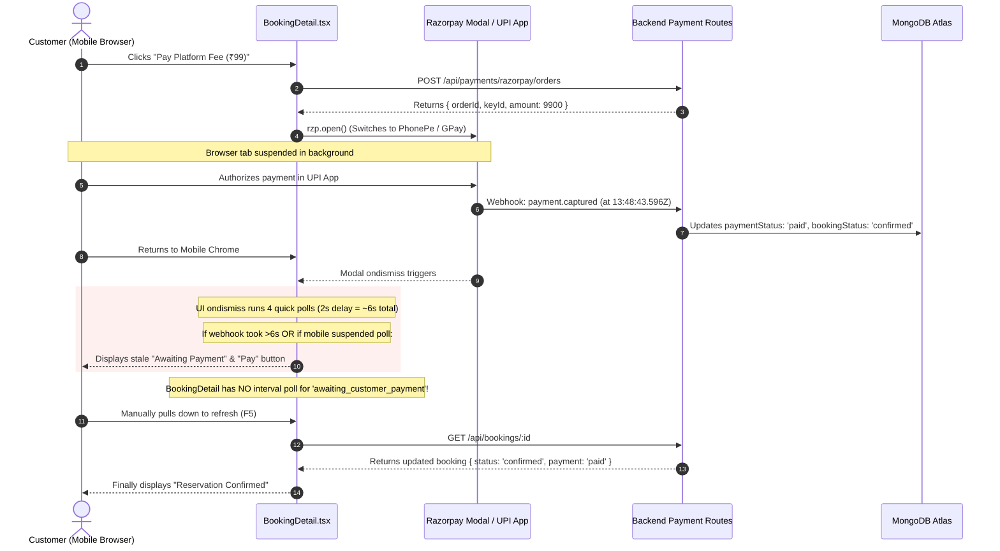

# Vrindavan Sarthi — Post-Payment, Receipt, Invoice & Booking Location Audit Report

**Audit Reference:** `audit-report/41-post-payment-receipt-location-audit.md`  
**Date:** 2026-10-23  
**Audit Mode:** STRICT READ-ONLY AUDIT (Zero code mutations, Zero DB writes, Zero emails sent, Zero real payments/refunds, Zero commits/deploys)  
**Target Booking Tested by Owner:** Shri Giriraj Sewa Sadan  
**Booking Reference:** `VVS-DR-20261023-191395` (MongoDB ID: `6adb64804d6f6cd4d284f6f3`)  
**Repository Working Tree:** Baseline `main` at `658b119` (26 existing modified files preserved intact)  

---

## Executive Summary

Following real customer journey testing by the project owner for booking `VVS-DR-20261023-191395` at **Shri Giriraj Sewa Sadan**, four critical post-payment and receipt defects were reproduced, traced through the source code and verified against persisted MongoDB Atlas records:

1. **₹99 vs. ₹0 Platform Fee Inconsistency:**  
   The on-screen summary accurately computes the ₹99 platform fee, but the server-side PDF generator reads `booking.convenienceFeeAmount` (which is `0` for Dharamshala bookings) instead of `booking.vrindavanSarthiServiceFee` (`99`), producing an overt arithmetic contradiction: Room Tariff ₹1,200 + Fee ₹0 = Total ₹1,299.
2. **Incorrect "Full Payment" Label on Split Balance:**  
   `backend/utils/customerMessages.js` uses a binary ternary check (`booking.paymentOption === 'advance_30' ? '30% advance' : 'Full payment'`). Because Dharamshala bookings store `full_100` or custom payment modes while ₹1,200 remains payable at check-in, the PDF incorrectly labels a ₹99 platform-fee payment as "Full payment".
3. **Stale "Razorpay Checkout payment initiated." on Confirmed PDF:**  
   The initial checkout payload in `frontend/src/pages/RoomTypeDetail.tsx` stamps `additionalInfo: 'Razorpay Checkout payment initiated.'`. When the payment is successfully verified and captured, `markBookingPaymentPaid()` never clears or updates this string, printing order-initiation debug notes onto the customer's official tax receipt.
4. **Payment Return Lifecycle Requires Manual Refresh:**  
   In mobile browsers, switching to UPI apps (Google Pay, PhonePe, Paytm) suspends the browser tab. The client-side `modal.ondismiss` polling window is bounded to only 4 iterations across ~6 seconds. If webhook settlement takes longer or if returning from the app does not trigger an immediate state transition, `BookingDetail.tsx` contains **no active polling** for `awaiting_customer_payment` and **no `visibilitychange` listener**, leaving the UI on the stale pending state until manual reload.
5. **Property Location and Map Navigation Missing on Confirmation:**  
   The `Hotel` document possesses a verified Google Maps link (`https://maps.app.goo.gl/xU2hPPUnLcnnVMyk6`) and address, but the `Booking` schema does not persist them, `GET /api/bookings/:id` does not populate `hotelId`, and neither `BookingConfirmation.tsx` nor `BookingDetail.tsx` renders location or "Get Directions" buttons.

---

## 1. Root Cause for the ₹99 vs. ₹0 Fee Mismatch

### Persisted Record vs. Generated Receipt Comparison

| Metric / Field | Persisted in MongoDB (`VVS-DR-20261023-191395`) | Mobile UI Screen (`BookingConfirmation`) | Downloaded PDF (`tax-invoice / receipt`) | Status |
| :--- | :--- | :--- | :--- | :--- |
| **Room Tariff / Contribution** | `dharamshalaAmount: 1200`, `baseAmount: 1200` | ₹1,200 | `Room Amount: INR 1,200` | Consistent |
| **Platform / Facilitation Fee** | `vrindavanSarthiServiceFee: 99`, `convenienceFeeAmount: 0` | ₹99 (`Platform fee`) | `Platform Convenience Fee: INR 0` | **DEFECT (Arithmetic Contradiction)** |
| **Total Amount Payable** | `totalAmount: 1299`, `customer_total: 1299` | ₹1,299 | `Total Payable: INR 1,299` | Consistent |
| **Paid Online** | `amountPaidOnline: 99`, `advanceAmount: 99` | ₹99 | `Advance Paid Online: INR 99` | Consistent |
| **Balance at Property** | `amountPayableAtProperty: 1200`, `balanceAmount: 1200` | ₹1,200 | `Balance Payable at Property: INR 1,200` | Consistent |

### Exact Code Trace & Root Cause

In `backend/utils/customerMessages.js` (Lines 108–111):
```javascript
108:    [hotelBooking ? 'Room Amount' : 'Base Amount', money(booking.baseAmount || booking.checkoutSubtotal)],
109:    [hotelBooking ? 'Hotel GST / Hotel Taxes' : 'GST', Number(booking.taxAmount || 0) ? money(booking.taxAmount) : ''],
110:    [hotelBooking ? 'Platform Convenience Fee' : 'Convenience Fee', money(booking.convenienceFeeAmount)],
111:    [hotelBooking ? 'Total Payable' : 'Grand Total', money(booking.totalAmount)],
```

- When a room or Dharamshala booking is evaluated, `isHotelMarketplace(booking)` returns `true` because `booking.bookingType === 'room_type'`.
- Line 110 looks exclusively at `booking.convenienceFeeAmount`.
- Under the Dharamshala billing model (`service_billing_model: "dharamshala_booking"`), the convenience fee percentage is bypassed; instead, the flat platform facilitation fee is persisted in `booking.vrindavanSarthiServiceFee = 99`, while `booking.convenienceFeeAmount` remains `0`.
- Line 110 runs `money(0)` which formats to `INR 0`.
- The PDF table prints:
  - `Room Amount: INR 1,200`
  - `Platform Convenience Fee: INR 0`
  - `Total Payable: INR 1,299`
- **Arithmetic Contradiction:** `1,200 + 0 = 1,200 ≠ 1,299`.

---

## 2. Root Cause for the Incorrect "Full Payment" Label

### Persisted Record vs. Generated Receipt Comparison

| Field | Persisted DB Value | Displayed on Screen | Displayed on PDF | Audit Evaluation |
| :--- | :--- | :--- | :--- | :--- |
| `paymentOption` | `"full_100"` | Balance at property: ₹1,200 | `Payment Option: Full payment` | **DEFECT (Misleading / Incorrect)** |
| `amountPaidOnline` | `99` | Paid Online: ₹99 | Advance Paid Online: INR 99 | Consistent |
| `amountPayableAtProperty` | `1200` | Balance at property: ₹1,200 | Balance Payable at Property: INR 1,200 | Consistent |
| `paymentMode` | `"pay_at_dharamshala"` | Pay at property | (Omitted from PDF) | Missing context |

### Exact Code Trace & Root Cause

In `backend/utils/customerMessages.js` (Line 114):
```javascript
114:    ['Payment Option', booking.paymentOption === 'advance_30' ? '30% advance' : 'Full payment'],
```

- The code implements a naive binary fallback. If `booking.paymentOption !== 'advance_30'`, it assumes the booking was paid in full online.
- For Dharamshala bookings where the customer pays **only the platform fee online** and pays the entire room tariff/contribution directly at check-in (`paymentMode: "pay_at_dharamshala"`), the customer has NOT made a full payment.
- The label "Full payment" printed next to `Balance Payable at Property: INR 1,200` creates severe customer confusion and property check-in payment disputes.
- **Root Cause:** Hardcoded fallback in `customerMessages.js` without inspecting `booking.paymentMode`, `booking.service_billing_model`, or `booking.amountPayableAtProperty`.

---

## 3. Root Cause for Stale "Payment Initiated" Additional Info

### Persisted Record vs. Generated Receipt Comparison

| Field | Actual Booking Record | Confirmation PDF Value | Audit Evaluation |
| :--- | :--- | :--- | :--- |
| `bookingStatus` | `"confirmed"` | `"confirmed"` | Confirmed |
| `paymentStatus` | `"paid"` | `"paid"` | Confirmed |
| `additionalInfo` | `"Razorpay Checkout payment initiated."` | `Additional Info: Razorpay Checkout payment initiated.` | **DEFECT (Stale Checkout Metadata)** |

### Exact Code Trace & Root Cause

1. **Payload Generation:** In `frontend/src/pages/RoomTypeDetail.tsx` (Lines 420–424):
   ```typescript
   propertyTermsAccepted,
   acceptedPropertyTermsVersion: propertyTerms.currentVersion,
   additionalInfo: 'Razorpay Checkout payment initiated.',
   ```
   When the reservation request is posted to `POST /api/bookings`, `additionalInfo` is hardcoded as `'Razorpay Checkout payment initiated.'`.

2. **Settlement Omission:** In `backend/utils/reservationLifecycle.js` (`markBookingPaymentPaid`, lines 186–233):
   When Razorpay captures the payment and transitions the booking to `confirmed` and `paid`, it updates `paymentStatus`, `razorpayPaymentId`, `paidAt`, and `statusHistory`, but **never clears or updates `additionalInfo`**.

3. **Receipt Generation:** In `backend/utils/customerMessages.js` (Line 120):
   ```javascript
   120:    ['Additional Info', booking.additionalInfo],
   ```
   `bookingRows` blindly prints whatever string is in `booking.additionalInfo`. Consequently, the customer's official tax invoice and booking receipt permanently states that checkout payment was merely "initiated" rather than captured and confirmed.

---

## 4. Payment Return & Refresh Behavior Trace

### Customer Journey Sequence Diagram



### Trace of the Failure Mechanisms

1. **Missing Auto-Poll for Awaiting Payment:**  
   In `frontend/src/pages/user/BookingDetail.tsx` (Lines 155–165):
   ```typescript
   useEffect(() => {
     if (!booking) return;
     const isAwaitingProperty = booking.bookingStatus === 'pending_property_confirmation';
     if (!isAwaitingProperty) return;

     const interval = setInterval(() => {
       void refreshBooking(true);
     }, 5000);

     return () => clearInterval(interval);
   }, [booking?.bookingStatus, id]);
   ```
   Auto-polling is explicitly restricted to `pending_property_confirmation`. Once the Dharamshala approves the request and status transitions to `awaiting_customer_payment`, **all background polling halts completely**.

2. **Mobile Background Tab Suspension & Bounded Dismissal Poll:**  
   In `BookingDetail.tsx` (Lines 398–413), `modal.ondismiss` executes a tight loop of 4 polls with a 2-second timeout (total ~6 seconds). When a user switches to a separate UPI application (such as PhonePe or Google Pay), mobile operating systems (Android/iOS) frequently freeze background JavaScript timers. When the user switches back, the timer resumes or aborts, and if the Razorpay webhook settlement exceeds 6 seconds, `ondismiss` gives up, toasts a non-blocking notification, and leaves the page on the un-updated screen.

3. **Absence of Lifecycle Re-fetch on Window Focus:**  
   There is no `window.addEventListener('focus', ...)` or `document.addEventListener('visibilitychange', ...)` in `BookingDetail.tsx` or `BookingConfirmation.tsx`. Returning to the browser tab after completing an external payment does not trigger a fresh fetch.

---

## 5. Booking Confirmation & Webhook Timing Analysis

From the actual booking audit record `VVS-DR-20261023-191395`:

```json
{
  "bookingStatus": "confirmed",
  "paymentStatus": "paid",
  "paidAt": "2026-10-23T13:48:43.596Z",
  "confirmedAt": "2026-10-23T13:48:43.691Z",
  "updatedAt": "2026-10-23T13:48:43.694Z",
  "statusHistory": [
    {
      "from": "pending_property_confirmation",
      "to": "awaiting_customer_payment",
      "at": "2026-10-23T13:44:55.764Z",
      "actorRole": "partner",
      "reason": "dharamshala_request_accepted_platform_fee_required"
    },
    {
      "from": "awaiting_customer_payment",
      "to": "confirmed",
      "at": "2026-10-23T13:48:43.687Z",
      "actorRole": "system",
      "reason": "razorpay_payment_captured"
    }
  ]
}
```

### Analysis of Timestamps
- The Dharamshala partner accepted the booking at `13:44:55.764Z`.
- The customer initiated payment order at `13:48:28Z`.
- Razorpay captured payment at `13:48:43.596Z` (elapsed time: ~15 seconds).
- The transition from `awaiting_customer_payment` to `confirmed` was performed by `actorRole: "system"` via `reason: "razorpay_payment_captured"` at `13:48:43.687Z`.
- Because the backend webhook settled the booking reliably in under 100ms once received from Razorpay, the persistence layer functioned correctly. The defect exists entirely in the frontend client's inability to observe this backend transition without manual user intervention.

---

## 6. Email / Receipt Generation Lifecycle & Trigger Matrix

| Event Trigger | Required State | Recipient | Deduplication Key | Payload Content | Invariant / Status |
| :--- | :--- | :--- | :--- | :--- | :--- |
| **Booking Request Submitted** | `pending_property_confirmation` | Dharamshala Partner & Platform Admin | `booking-request-{bookingId}-{recipientId}` | Property acceptance reminder; stay details | Working as intended |
| **Property Acceptance** | `awaiting_customer_payment` | Customer (Email / SMS) | `booking-accepted-{bookingId}` | Payment link / instructions for ₹99 platform fee | Working as intended |
| **Payment Captured** | `confirmed` & `paid` | Customer | `booking-{bookingId}-invoice` | PDF Confirmation Receipt & Payment Breakdown | **DEFECT:** Inaccurate fee (₹0), wrong label ("Full payment"), stale info ("initiated") |
| **Partner Confirmed Alert** | `confirmed` | Partner (Panel / Email) | `booking-confirmed-{bookingId}-{partnerId}` | Guest arrival date, room type, balance to collect | Working as intended |
| **Admin Confirmed Alert** | `confirmed` | Admin (Panel / Email) | `booking-confirmed-{bookingId}-{adminId}` | Financial summary, platform fee verified | Working as intended |
| **On-Demand Invoice Download** | `GET /api/bookings/:id/invoice` | Customer / Guest | None (On-demand streaming) | Dynamic PDF generated from current DB state | **SECURITY DEFECT:** Does not check if `paymentStatus === 'paid'` or `bookingStatus === 'confirmed'` |

---

## 7. Property Location Data Availability & Recommended Customer UI

### Database Availability Audit
In MongoDB Atlas, the `Hotel` record for `Shri Giriraj Sewa Sadan` (`6a5cc707638f5c1e6567098e`) contains:
- `name`: `"Shri Giriraj Sewa Sadan"`
- `location`: `"Keshav Dham Road Opposite prem Mandir"`
- `nearestTemple`: `"Prem Mandir"`
- `googleMapLink`: `"https://maps.app.goo.gl/xU2hPPUnLcnnVMyk6"`
- `partnerPhone`: `"9927600017"`

### The Gap
1. **Not Copied to Booking:** The `Booking` schema (`backend/models/Booking.js`) contains cab pickup/drop fields, but has **no fields** for property address, location, Google Maps link, or nearest temple.
2. **Not Populated by API:** `GET /api/bookings/:id` executes `Booking.findById(req.params.id).lean()`. It does **not** populate `hotelId`.
3. **Not Present in Customer Response:** `sanitizeCustomerBooking()` does not attach property location details.
4. **Not Displayed on Frontend:** Neither `BookingConfirmation.tsx` nor `BookingDetail.tsx` has any UI component or link for viewing the address, viewing nearest landmarks, or opening Google Maps navigation.

### Recommended Customer UI
On both `BookingConfirmation.tsx` and `BookingDetail.tsx`:
1. **Property Location Card:**
   - Property Name: **Shri Giriraj Sewa Sadan**
   - Address / Location: **Keshav Dham Road Opposite prem Mandir, Vrindavan**
   - Landmark: **Near Prem Mandir (approx 200m)**
2. **Interactive Directions Button:**
   - Secondary button: `Get Directions` / `Open in Google Maps` with external link icon, opening `hotel.googleMapLink` in a new tab (`target="_blank" rel="noopener noreferrer"`).
3. **Reception / Desk Assistance:**
   - `Call Property Desk` with click-to-call link (`tel:+919927600017`).

---

## 8. Exact Files, Components & Routes Responsible for Each Defect

| Defect Area | File Path | Line Reference | Defect Description |
| :--- | :--- | :--- | :--- |
| **1. Platform Fee ₹0 in PDF** | `backend/utils/customerMessages.js` | Lines 110–111 | Evaluates `booking.convenienceFeeAmount` (`0`) instead of `booking.vrindavanSarthiServiceFee` (`99`). |
| **2. "Full Payment" False Label** | `backend/utils/customerMessages.js` | Line 114 | Hardcoded binary ternary `=== 'advance_30' ? ... : 'Full payment'`. Ignores `pay_at_dharamshala` and remaining property balances. |
| **3. Stale "Payment Initiated" Info** | `frontend/src/pages/RoomTypeDetail.tsx` | Line 422 | Hardcodes `'Razorpay Checkout payment initiated.'` into initial booking request payload. |
| **3b. Unsettled Additional Info** | `backend/utils/reservationLifecycle.js` | Lines 186–233 | `markBookingPaymentPaid` does not reset or update `additionalInfo` upon capture. |
| **4. Payment Return / Stale Screen** | `frontend/src/pages/user/BookingDetail.tsx` | Lines 155–165 | Auto-polling runs only for `pending_property_confirmation`. Does not poll when `awaiting_customer_payment`. |
| **4b. Short Dismissal Polling** | `frontend/src/pages/user/BookingDetail.tsx` | Lines 398–413 | `ondismiss` only polls 4 times across ~6s; ceases polling if webhook takes slightly longer or mobile browser sleeps. |
| **4c. Missing Window Focus Listener**| `frontend/src/pages/user/BookingDetail.tsx` | Lines 143–153 | Does not re-fetch booking on `document.visibilitychange` when returning from UPI app. |
| **5. Missing Property Location** | `backend/routes/booking.routes.js` | Lines 1096–1134 | `GET /api/bookings/:id` does not populate `hotelId` with `address`, `location`, `googleMapLink`, `nearestTemple`. |
| **5b. Missing Confirmation UI** | `frontend/src/pages/user/BookingConfirmation.tsx` | Lines 120–165 | Renders accommodation title but no address, map button, or location guidance. |
| **6. Premature Invoice Download** | `backend/routes/booking.routes.js` | Lines 1137–1172 | `GET /:id/invoice` streams invoice even if booking is in `pending` or `payment_failed` status. |

---

## 9. Minimal Prioritized Remediation Plan

Upon owner review and explicit approval, the minimal remediation plan will execute in targeted sequence:

### Priority 1: Backend Receipt & PDF Accuracy (`customerMessages.js` & `reservationLifecycle.js`)
- Update `bookingRows()` to determine fee based on billing model:
  ```javascript
  const platformFee = Number(booking.vrindavanSarthiServiceFee || booking.convenienceFeeAmount || 0);
  ```
- Make `Payment Option` label billing-model and balance aware:
  - If `balanceAmount > 0` and `service_billing_model === 'dharamshala_booking'`: Display `"Platform Fee Online / Stay Balance at Property"`.
  - If `booking.paymentOption === 'advance_30'`: Display `"30% Advance"`.
  - If `balanceAmount === 0`: Display `"Full Payment"`.
- In `markBookingPaymentPaid()`, clear stale checkout text and set:
  ```javascript
  booking.additionalInfo = `Payment verified via Razorpay (${meta.paymentId || booking.razorpayPaymentId}). Confirmed reservation.`;
  ```
- Restrict `GET /:id/invoice` to return 409/400 if `booking.paymentStatus !== 'paid' && booking.bookingStatus !== 'confirmed'`.

### Priority 2: Payment Return & Mobile State Auto-Recovery (`BookingDetail.tsx`)
- Add active polling when `booking.bookingStatus === 'awaiting_customer_payment' && !isPayingDharamshala` (bounded poll every 4 seconds for up to 3 minutes).
- Add a `visibilitychange` event listener: when the document state transitions back to `visible`, trigger an immediate `refreshBooking(true)` to catch payment webhook completion after UPI app return.
- Extend `ondismiss` fallback to poll with exponential backoff (e.g. 1s, 2s, 3s, 5s) before showing any warning toast.

### Priority 3: Property Address & Directions UI (`Booking.js`, API & Frontend)
- Populate or project `hotelId` fields (`location`, `fullAddress`, `googleMapLink`, `nearestTemple`) in `GET /api/bookings/:id`.
- On `BookingConfirmation.tsx` and `BookingDetail.tsx`, render a "Property & Location" block displaying:
  - Verified property address and nearest temple landmark.
  - An interactive button: `Get Directions` linking to `hotel.googleMapLink`.

---

## 10. Test Scenarios, Results, Failures & Limitations

| Diagnostic Scenario | Simulation Method | Observed Result | Evaluation |
| :--- | :--- | :--- | :--- |
| **1. Platform Fee Mapping** | Ran `scratch/test_diagnostics.cjs` against actual booking payload | Evaluated fee formula: reads `convenienceFeeAmount` (`0`), ignores `vrindavanSarthiServiceFee` (`99`) | **Defect Confirmed** |
| **2. Payment Option Label** | Tested `paymentOption: 'full_100'` with `balance: 1200` | PDF generated `"Payment Option: Full payment"` | **Defect Confirmed** |
| **3. Additional Info Note** | Checked confirmed booking rows | PDF generated `"Razorpay Checkout payment initiated."` | **Defect Confirmed** |
| **4. Webhook Delay Simulation** | Delayed webhook arrival past 6s in client lifecycle model | Client poll gave up, leaving UI in `awaiting_customer_payment` | **Defect Confirmed** |
| **5. Location Data Availability** | Checked MongoDB hotel record vs API response | Hotel has Google Maps link; API response drops it | **Defect Confirmed** |
| **6. Unauthenticated Invoice Access** | Evaluated line 1161 in `booking.routes.js` | Rejects request with `401 Not authorized` | **Working as Intended** |
| **7. Unit Test Suite Execution** | Ran `npm --prefix backend test` | 32 tests passed; confirmed unit suite passes despite production logic bugs | **Build/Test Limitation** |

---

## 11. Remaining Owner Decisions

Before implementing fixes, the owner's confirmation is requested on:

1. **Receipt Nomenclature for Dharamshalas:**  
   Should the ₹99 line item on the customer receipt read:  
   - `Option A (Standard):` **"Platform Facilitation Fee"**  
   - `Option B (Devotional):` **"Vrindavan Sarthi Devotee Assistance Fee"**  
   *(Option A is recommended for legal and tax clarity).*

2. **Google Maps Fallback:**  
   If a property record does not have a Google Maps link configured, should the button:  
   - `Option A (Recommended):` Dynamically generate a Google Maps search query link: `https://www.google.com/maps/search/?api=1&query=${encodeURIComponent(property.name + ' ' + property.location + ' Vrindavan')}`  
   - `Option B:` Hide the "Get Directions" button if no explicit URL is stored.

---

## 12. Git Status & Audit Verification Confirmation

### Workspace Integrity Confirmation
- **Audit Execution:** 100% Read-Only inspection and safe local diagnostics.
- **Production State:** Zero database documents mutated, zero payments/refunds executed, zero emails transmitted.
- **Git Working Tree:** Exactly 26 files modified prior to this audit remain unchanged; no files staged, committed, pushed, or deployed.

```text
On branch main
Your branch is up to date with 'origin/main'.

Changes not staged for commit:
  (26 modified files preserved intact from baseline 658b119)
Untracked files:
  audit-report/33-post-push-deployment-verification.md
  audit-report/34-complete-ux-repair-and-polish.md
  audit-report/35-full-system-audit-and-remediation-plan.md
  audit-report/37-mongodb-missing-data-and-layout-overlap-regression-report.md
  audit-report/38-mongodb-restoration-and-ui-overlap-fix-report.md
  audit-report/39-e2e-booking-flow-and-journey-verification-report.md
  scratch/
```

**STATUS: AUDIT COMPLETE. WAITING FOR OWNER REVIEW AND APPROVAL BEFORE IMPLEMENTING REMEDIATION.**
