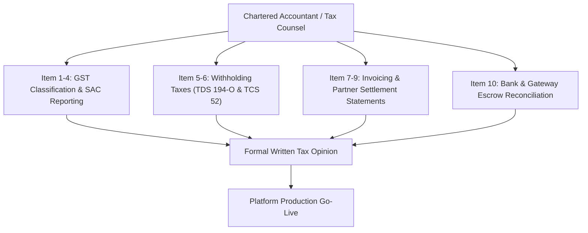

# VRINDAVAN SARTHI — CHARTERED ACCOUNTANT (CA) TAX COMPLIANCE REVIEW CHECKLIST

**Platform:** Vrindavan Sarthi OTA  
**Repository:** `https://github.com/deepakjadon1902/vrindavan-sarthi.git`  
**Workspace:** `D:\vrindavan-sarthi`  
**Phase:** Phase 5.7.5 Governance Closure  
**Approved Baseline Commit:** `1295a53036a9eaa201aaf81b38990fd706a5669e`  
**Date:** November 6, 2026  
**Status:** **PENDING CA REVIEW & FORMAL TAX OPINION**

---

## 1. PURPOSE & AUDIT NOTICE

This document serves as a comprehensive statutory and tax review checklist prepared for the external Chartered Accountant (CA) and GST legal counsel of Vrindavan Sarthi.

> [!WARNING]
> **LEGAL NOTICE:** Nothing in this document or the platform source code constitutes formal legal or tax advice. The tax classifications and statutory treatments documented herein represent preliminary software engineering assumptions and must be validated, amended, or certified by a practicing Chartered Accountant prior to commercial go-live.

---

## 2. 10-POINT STATUTORY TAX REVIEW CHECKLIST

### Item 1: GST Treatment of Accommodation Bookings

- **Current Software Behavior:**  
  The rate engine calculates GST on hotel room tariffs based on the effective room rate per night:
  - $\le ₹7,500/\text{night}$: 5% GST (CGST 2.5% + SGST 2.5% or IGST 5%).
  - $> ₹7,500/\text{night}$: 18% GST (CGST 9% + SGST 9% or IGST 18%).  
  For Dharamshalas, room GST calculation is disabled (`taxEnabled: false`).
- **Outstanding Compliance Question:**  
  Under Section 9(5) of the CGST Act, 2017, is Vrindavan Sarthi (as an e-commerce operator) liable to pay the GST on accommodation services supplied through it where the hotel/dharamshala supplier is unregistered, or does the registered partner remit GST directly?
- **Required Supporting Records:**  
  Partner GSTIN registration certificates, property category declarations, daily reservation tax ledgers.
- **CA Decision Required:**  
  Confirm whether Section 9(5) applies to Vrindavan Sarthi lodging transactions and specify the platform's GST filing liabilities for registered vs. unregistered hotel partners.
- **Software Changes Needed After CA Approval:**  
  If Section 9(5) mandates platform remittance for unregistered partners, software must segregate bookings by partner GST registration status and route tax collected into the platform's tax payable ledger.

---

### Item 2: GST Treatment of Cancellation Charges & Retained Advances

- **Current Software Behavior:**  
  On voluntary customer cancellations of 30% advance reservations, the online advance is retained. The platform deducts contracted commission and credits the remainder to the hotel partner as a breakage entitlement. The software does not currently calculate or append GST to the retained advance.
- **Outstanding Compliance Question:**  
  Under CBIC Circular No. 178/10/2022-GST (dated 03-Aug-2022), does the retained 30% advance constitute consideration for the "agreed tolerance of an act / cancellation of hotel accommodation" (taxable at the accommodation rate), or is it non-taxable liquidated damages for breach of contract? Furthermore, does the platform owe GST on its retained commission portion?
- **Required Supporting Records:**  
  Cancellation policy snapshots, terms of service contracts with partners, cancellation audit logs.
- **CA Decision Required:**  
  Define the exact GST characterization of the retained advance:
  1. Is the partner's breakage entitlement subject to lodging GST?
  2. Does the platform commission deducted attract 18% GST?
- **Software Changes Needed After CA Approval:**  
  If taxable, software must generate GST credit/debit records and calculate net tax components on breakage allocations.

---

### Item 3: GST Treatment & Invoicing of Convenience Fees

- **Current Software Behavior:**  
  Platform charges a convenience fee (4.45% of pre-tax tariff for hotels, or flat ₹0 to ₹150 for Dharamshalas). On voluntary customer cancellation, the fee is 100% retained. On property failure, the fee is 100% refunded to the customer.
- **Outstanding Compliance Question:**  
  What is the correct SAC code, and is Vrindavan Sarthi required to generate an automated B2C tax invoice to the customer for the retained convenience fee upon cancellation?
- **Required Supporting Records:**  
  Razorpay payment capture webhooks, convenience fee calculation formulas.
- **CA Decision Required:**  
  Confirm SAC classification (SAC 9985 / 9983), verify that 18% GST applies, and determine whether a consolidated monthly tax invoice or individual digital tax invoice per booking is mandatory.
- **Software Changes Needed After CA Approval:**  
  Integrate an automated PDF tax invoice generator for customer convenience fees sent via email/download link.

---

### Item 4: SAC Classification & GSTR-1 Reporting

- **Current Software Behavior:**  
  The platform records transaction amounts in integer paise but does not produce GSTR-1 export payloads.
- **Outstanding Compliance Question:**  
  What are the precise SAC codes to be used in GSTR-1 filings:
  - Lodging Accommodation: SAC 996311 / 996322?
  - Platform Commission: SAC 998311 / 998599?
  - Convenience / Booking Fee: SAC 998599?
  How should B2C convenience fee collections be reported in Table 7 (B2C Others) of GSTR-1?
- **Required Supporting Records:**  
  Monthly platform revenue ledger, partner billing profiles.
- **CA Decision Required:**  
  Approve official SAC mapping for all revenue streams and define the GSTR-1 monthly filing schedule.
- **Software Changes Needed After CA Approval:**  
  Implement a GSTR-1 analytical export utility generating monthly CSV/JSON formatted for the GST portal.

---

### Item 5: Section 194-O TDS Applicability, Rate & Responsibility

- **Current Software Behavior:**  
  The partner payout calculation engine computes net payable remittance:
  $$\text{Net Remittance} = (\text{Gross Tariff} - \text{Commission}) - \text{Desk Collection} + \text{Breakage Entitlement}$$
  The software records gross amounts and does NOT automatically deduct 1% TDS in the database.
- **Outstanding Compliance Question:**  
  Under Section 194-O of the Income Tax Act, 1961:
  1. Is Vrindavan Sarthi required to deduct 1% TDS on the gross value of accommodation booked through it?
  2. Does Section 194-O apply to cancellation breakage entitlements paid to partners?
  3. Should TDS be withheld programmatically in the software ledger, or by the partner bank payout API / nodal account?
- **Required Supporting Records:**  
  Partner PAN numbers, bank verification logs, payout remittance ledgers.
- **CA Decision Required:**  
  Determine the exact withholding layer (software ledger vs. payment gateway payout API) and confirm partner threshold exemptions (e.g., individuals with gross sales $< ₹500,000$ providing PAN).
- **Software Changes Needed After CA Approval:**  
  If software ledger deduction is required, implement a `TDS_WITHHELD` event in `FinancialLedgerEntry` and deduct 1% from partner remittance balances.

---

### Item 6: Section 52 TCS Applicability & GSTR-8 Reporting

- **Current Software Behavior:**  
  Platform tracks partner gross volumes and cancellations but does not calculate 1% TCS (0.5% CGST + 0.5% SGST or 1% IGST) or prepare GSTR-8 return tables.
- **Outstanding Compliance Question:**  
  Is Vrindavan Sarthi registered under Section 52 of the CGST Act as an e-commerce operator required to collect TCS at 1% on net taxable supplies? What is the exemption status for charitable Dharamshala accommodations?
- **Required Supporting Records:**  
  Platform GSTIN TCS registration, monthly net taxable supply aggregates per partner GSTIN.
- **CA Decision Required:**  
  Certify TCS liability, approve net taxable supply calculation logic, and specify GSTR-8 return workflow.
- **Software Changes Needed After CA Approval:**  
  Add automated TCS calculation (1% on net taxable supply) to the partner payout aggregation engine and GSTR-8 monthly report generation.

---

### Item 7: Partner Settlement Statements & Tax Reconciliation

- **Current Software Behavior:**  
  Partner portal displays `/partner/payments` with:
  - Gross Tariff
  - Platform Commission (10%)
  - Desk Collections
  - Cancellation Breakage Entitlements
  - Net Payable Remittance Balance
- **Outstanding Compliance Question:**  
  Does the partner financial statement meet Indian statutory standards for a valid commercial settlement sheet? Does it require explicit itemization of GST on commission (18%), TDS (194-O), and TCS (Section 52)?
- **Required Supporting Records:**  
  Partner bank account statements, weekly settlement batch summaries.
- **CA Decision Required:**  
  Provide the mandatory layout of the statutory partner settlement statement and approve the treatment of desk cash offsets.
- **Software Changes Needed After CA Approval:**  
  Update `PartnerPayments.tsx` and PDF settlement exports to include formal tax withholding rows (TDS, TCS, GST on commission).

---

### Item 8: Refund & Cancellation Credit-Note Requirements

- **Current Software Behavior:**  
  When a booking is cancelled with partial or full refund, the software updates `refundableAmount` and records payment refund statuses in MongoDB.
- **Outstanding Compliance Question:**  
  Under Section 34 of the CGST Act, 2017, when a customer cancels an accommodation booking after payment, is Vrindavan Sarthi required to issue a formal GST Credit Note for the customer refund? If so, within what statutory timeframe?
- **Required Supporting Records:**  
  Original invoice numbers, refund transaction IDs, cancellation timestamps.
- **CA Decision Required:**  
  Confirm Credit Note issuance rules for B2C consumer cancellations and establish numbering sequence conventions.
- **Software Changes Needed After CA Approval:**  
  Implement a credit note generation engine linking refund events to original booking invoice IDs.

---

### Item 9: Platform Commission Invoicing to Hotel Partners

- **Current Software Behavior:**  
  Platform commission is deducted automatically during weekly settlement runs from online collections. No separate monthly tax invoice is generated for the partner.
- **Outstanding Compliance Question:**  
  Is Vrindavan Sarthi required to issue a monthly B2B GST tax invoice to each hotel partner for the total platform commission earned during that month (+ 18% GST), so the hotel partner can claim Input Tax Credit (ITC)?
- **Required Supporting Records:**  
  Partner GSTINs, monthly commission aggregates per property.
- **CA Decision Required:**  
  Establish the monthly B2B billing cycle and mandatory invoice formatting for platform commissions charged to partners.
- **Software Changes Needed After CA Approval:**  
  Implement automated end-of-month partner commission tax invoice generator with B2B GSTIN compliance.

---

### Item 10: Reconciliation Between Razorpay Collections, Bank Settlements & Partner Liabilities

- **Current Software Behavior:**  
  The system tracks online advance collections via Razorpay order IDs and records integer-paise financial ledger entries.
- **Outstanding Compliance Question:**  
  How should the multi-day settlement delay (T+2 / T+3 days) between Razorpay gateway collections and nodal bank credit be reconciled against the platform's immediate ledger entries and weekly partner payout cycles?
- **Required Supporting Records:**  
  Razorpay settlement UTR files, nodal bank account statements, internal ledger settlement tables.
- **CA Decision Required:**  
  Approve the bank reconciliation procedure and internal control framework for customer advances held in escrow/nodal accounts.
- **Software Changes Needed After CA Approval:**  
  Implement an automated UTR / bank statement reconciliation import module matching payment gateway settlement batches to MongoDB ledger records.

---

## 3. SUMMARY STATUS FOR CA SIGN-OFF

| Workstream | Number of Items | Status |
|---|:---:|:---:|
| GST Classification & Invoicing | 4 | `PENDING CA REVIEW` |
| Withholding Taxes (TDS & TCS) | 2 | `PENDING CA REVIEW` |
| Settlement Statements & Credit Notes | 3 | `PENDING CA REVIEW` |
| Banking & Escrow Reconciliation | 1 | `PENDING CA REVIEW` |
| **Total Checklist Items** | **10** | **ALL PENDING CA REVIEW** |
