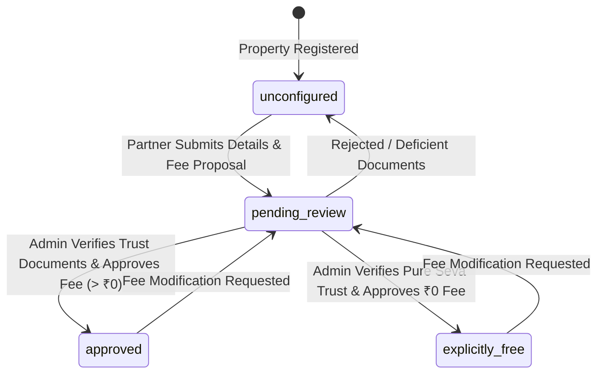

# VRINDAVAN SARTHI — REAL DHARAMSHALA PROPERTY ONBOARDING STANDARD OPERATING PROCEDURE (SOP)

**Platform:** Vrindavan Sarthi OTA  
**Repository:** `https://github.com/deepakjadon1902/vrindavan-sarthi.git`  
**Workspace:** `D:\vrindavan-sarthi`  
**Phase:** Phase 5.7.5 Governance Closure  
**Approved Baseline Commit:** `1295a53036a9eaa201aaf81b38990fd706a5669e`  
**Date:** November 6, 2026  
**Document Status:** **PRODUCTION OPERATIONAL STANDARD OPERATING PROCEDURE (SOP)**

---

## 1. PURPOSE & SACRED MISSION

Vrindavan Sarthi provides digital connectivity for pilgrims visiting the sacred Brij Dham (Vrindavan, Mathura, Barsana, Govardhan, Nandgaon). Many accommodations are charitable trusts, ashrams, and community Dharamshalas dedicated to selfless pilgrim service (*Nishkam Seva*).

This Standard Operating Procedure (SOP) defines the mandatory governance, document collection, physical verification, and individual fee-approval lifecycle for every Dharamshala prior to enabling reservations.

> [!IMPORTANT]
> **GOVERNANCE MANDATE:**  
> 1. No property may be listed with a service fee without individualized administrative review.
> 2. No Dharamshala may be mass-approved or assigned a universal default fee (e.g., ₹79 or ₹120).
> 3. ₹0 fee is strictly enforced for charitable ashrams that request 100% free pilgrim reservations.
> 4. Unreviewed or unconfigured properties are permanently blocked from receiving bookings by hard software validation gates.

---

## 2. THE FOUR-STATE LIFECYCLE GOVERNANCE MODEL

Every Dharamshala in Vrindavan Sarthi exists in exactly one of four mutually exclusive states in `Hotel.js`:



| Lifecycle State | Enum Value | Fee Range | Booking Engine Behavior | Visual Badge in Admin UI |
|---|---|:---:|---|---|
| **Unconfigured** | `'unconfigured'` | Undefined | **STRICTLY BLOCKED (400 Bad Request)**. Cannot accept holds or reservations. | Gray `Unconfigured` |
| **Pending Review** | `'pending_review'` | Proposed Fee | **STRICTLY BLOCKED (400 Bad Request)**. Awaiting admin review and KYC sign-off. | Amber `⚠ Pending Owner Review` |
| **Approved** | `'approved'` | ₹1 to ₹250 | **ACTIVE FOR BOOKING**. Service fee applied transparently to pilgrim quote. | Green `✓ Owner Approved` |
| **Explicitly Free** | `'explicitly_free'` | Exactly ₹0 | **ACTIVE FOR BOOKING**. ₹0 platform fee applied; 100% Free Seva for pilgrims. | Emerald `✓ Explicitly Free (₹0)` |

### Software Validation Gate (`validateDharamshalaFeeApproval`):
Located in [`backend/utils/dharamshalaLifecycle.js`](file:///D:/vrindavan-sarthi/backend/utils/dharamshalaLifecycle.js), this gate evaluates before any inventory lock or reservation is created:
- If status is `'unconfigured'` or `'pending_review'` $\implies$ Throws HTTP 400 Bad Request:  
  *"This Dharamshala platform service fee is pending owner review and approval. An administrator must approve the service fee before bookings can be accepted."*
- If status is `'approved'` or `'explicitly_free'` $\implies$ Returns `true`, permitting reservation creation.

---

## 3. INDIVIDUAL DHARAMSHALA ONBOARDING CHECKLIST

Every Dharamshala application must be verified against this 14-point checklist by a Super Admin or Operations Admin prior to fee approval:

```markdown
### PROPERTY ONBOARDING COMPLIANCE RECORD
1. Property Legal Name: _________________________________________________
2. Owner / Trust / Managing Entity: ______________________________________
3. Authorized Representative:
   - Full Name: _________________________________________________________
   - Designation (Trustee / Mahant / Manager): ___________________________
   - Verified Mobile Phone: _____________________________________________
   - Government ID (Aadhaar / Passport / Voter ID): ____________________
4. Property Physical Address:
   - Street / Marg / Landmark: __________________________________________
   - City / Town (Vrindavan / Mathura / Barsana / Govardhan): ___________
   - Geo-Coordinates (Lat / Long / Google Maps URL): ____________________
5. Ownership or Management Proof:
   - [ ] Registered Trust Deed
   - [ ] Society Registration Certificate
   - [ ] Municipal Tax Receipt / Property Electricity Bill
   - [ ] Temple Committee Sanad / Lease Agreement
6. Applicable Tax & Non-Profit Registration Documents:
   - [ ] PAN Card of Trust / Society
   - [ ] 12A / 80G Registration Certificate (if claiming tax-exempt donations)
   - [ ] GSTIN Certificate (if registered for commercial rooms)
7. Board / Trustee Authorization:
   - [ ] Signed Trustee Board Resolution authorizing representative
   - [ ] Written declaration of pilgrim accommodation terms
8. Proposed Service Fee: ₹ _________ per booking
9. Explicit ₹0 Free Seva Confirmation (if applicable):
   - [ ] Signed Seva Declaration: Trust confirms no commercial room charges; requests ₹0 platform fee for pilgrims.
10. Physical On-Site Verification Evidence:
    - [ ] On-site photos of entrance, rooms, cleanliness, and reception desk
    - [ ] Inspector / Verifier Name: ____________________________________
    - [ ] Verification Inspection Date: _________________________________
11. Approval Date: ________________________ (ISO Timestamp)
12. Approving Administrator:
    - Admin Name: _______________________________________________________
    - Admin Role: `super_admin` / `operations_admin`
    - Admin User ID: ____________________________________________________
13. Audit Trail Reference:
    - AuditLog ID: `AUDIT-DHA-FEE-_______________________________________`
14. Final Operational Status:
    - [ ] `active` (Available for public discovery)
    - [ ] `inactive` (Hidden from search)
```

---

## 4. STEP-BY-STEP OPERATIONAL ONBOARDING SOP

### Phase 1: Intake & Document Collection (T+0 to T+2 Business Days)
1. Partner registers via Partner Portal and submits property details, selecting `propertyType: "dharamshala"`.
2. Property is initially created with `dharamshalaFeeApprovalStatus: "unconfigured"` and `dharamshalaFeeConfigured: false`.
3. Representative uploads Trust Deed, Society Registration, Trustee Resolution, Manager ID proof, and utility bills to the secure partner document repository.
4. Partner indicates requested platform service fee (or checks *"Request Pure Free Seva (₹0)"*). Status transitions to `pending_review`.

### Phase 2: Due Diligence & Physical Verification (T+2 to T+5 Business Days)
1. **Document Inspection:** Vrindavan Sarthi legal team inspects trust deed to ensure managing trustees match the authorized representative.
2. **On-Site Field Verification:** Local Brij operations representative visits property in Vrindavan, Mathura, Barsana, or Govardhan:
   - Verifies physical existence, room unit counts, hygiene, drinking water, and safety.
   - Confirms desk check-in process and ensures property is not operating as an unverified commercial hotel posing as a dharamshala.
3. Field verifier uploads signed inspection report and photographic proof to admin console.

### Phase 3: Administrative Fee Review & Approval (T+5 to T+7 Business Days)
1. Super Admin navigates to `/admin/policies` $\to$ **Dharamshala Service Fees**.
2. Reviews property inspection report and trust deed scan.
3. **Approval Execution:**
   - **For Pure Seva Ashrams:** Admin clicks **"Set Free Seva (₹0)"**. System updates `dharamshalaServiceFee: 0`, `dharamshalaFeeApprovalStatus: "explicitly_free"`, and `dharamshalaFeeConfigured: true`.
   - **For Maintenance Fee Dharamshalas:** Admin verifies reasonable fee (typically ₹79 to ₹150 for electricity/cleaning maintenance). Inputs fee, provides mandatory justification, and clicks **"Save & Approve Fee"**. System updates `dharamshalaServiceFee: <Amount>`, `dharamshalaFeeApprovalStatus: "approved"`, and `dharamshalaFeeConfigured: true`.
4. Platform immutably logs the event in `AuditLog` collection recording administrator ID, IP address, justification, and timestamp.
5. Automated SMS/Email alert is dispatched to partner confirming operational listing activation.

### Phase 4: Ongoing Monitoring & Annual Audit
1. Property fee is reviewed annually. Any partner request to increase fees reverts status to `pending_review` until re-approved by Super Admin.
2. Guest reviews and support tickets are monitored for any complaints regarding unauthorized cash demands at property reception.

---

## 5. PROHIBITIONS & ANTI-ABUSE MEASURES

> [!CAUTION]
> **STRICT COMPLIANCE DIRECTIVES:**
> - **NO MASS-APPROVALS:** The script or database tool must never execute bulk `$set: { dharamshalaFeeApprovalStatus: 'approved' }` across all properties. Every property must be reviewed individually.
> - **NO UNIVERSAL FEES:** Platform fees must reflect each property's genuine operational circumstances (₹0 for pure seva; nominal ₹79-₹150 for maintenance).
> - **NO AUTOMATIC COMMERCE CONVERSION:** Commercial hotels must never be converted to Dharamshalas to evade lodging GST. Attempting to set a Dharamshala fee on a commercial hotel returns HTTP 400 Bad Request.
> - **SYNTHETIC DATA BOUNDARY:** Test fixtures in staging databases are strictly ephemeral synthetic artifacts and must never be copied, migrated, or imported into production databases.
