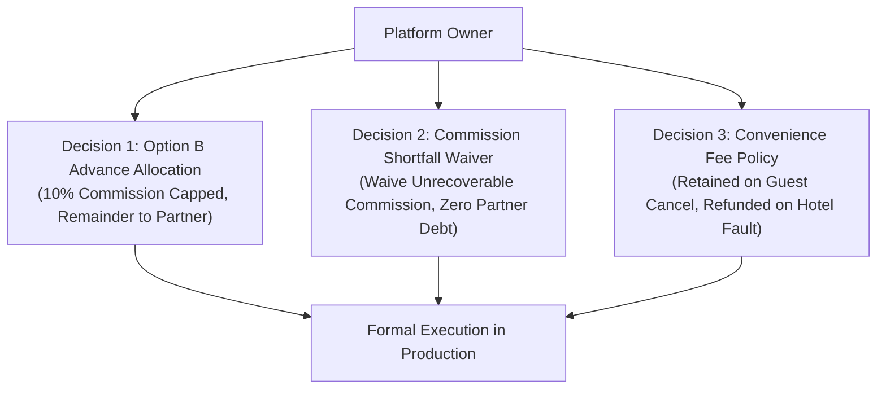

# VRINDAVAN SARTHI — FINANCIAL GOVERNANCE DECISION REGISTER
## Executive Policy Decision Document for Platform Owner Sign-Off

**Platform:** Vrindavan Sarthi OTA  
**Repository:** `https://github.com/deepakjadon1902/vrindavan-sarthi.git`  
**Workspace:** `D:\vrindavan-sarthi`  
**Phase:** Phase 5.7.5 Governance Closure  
**Approved Baseline Commit:** `1295a53036a9eaa201aaf81b38990fd706a5669e`  
**Date:** November 6, 2026  
**Document Status:** **AWAITING FORMAL OWNER DECISION & SIGN-OFF**

---

## 1. PURPOSE & DECISION CONTEXT

This document formalizes the accounting, commercial, and financial governance policies for Vrindavan Sarthi. It presents the exact mathematical formulas, current software behaviors, edge-case shortfall mechanics, and business policy options that require explicit Platform Owner approval prior to production commercial deployment.

---

## 2. DECISION AREA A: RETAINED 30% ADVANCE OWNERSHIP (OPTION B)

### 2.1 The Business Rule
When a pilgrim books accommodation under the standard `advance_30` payment mode and subsequently initiates a voluntary cancellation, the customer refund is ₹0 pursuant to the cancellation policy terms.

The online advance retained by the platform is apportioned between the hospitality partner and Vrindavan Sarthi as follows:
1. **Convenience Fee ($CF$):** Non-refundable fee for digital platform transaction facilitation. 100% retained by Vrindavan Sarthi.
2. **Room Advance Portion ($A_{\text{room}}$):** Net advance tariff collected online ($A_{\text{total}} - CF$).
3. **Platform Breakage Commission ($C_{\text{actual}}$):** Platform retains its contracted commission (default 10% of gross hotel tariff), strictly capped by the available room advance portion.
4. **Partner Breakage Entitlement ($E_{\text{partner}}$):** The entire remainder of the room advance portion is credited to the partner as compensation for blocked inventory ($A_{\text{room}} - C_{\text{actual}}$).

### 2.2 Mathematical Model & Conservation Law

$$\text{Retained Online Advance } (A_{\text{total}}) = A_{\text{room}} + CF$$
$$\text{Platform Commission } (C_{\text{actual}}) = \min(C_{\text{contract}}, A_{\text{room}})$$
$$\text{Partner Breakage Entitlement } (E_{\text{partner}}) = A_{\text{room}} - C_{\text{actual}}$$
$$\text{Platform Breakage Retained } (R_{\text{platform}}) = C_{\text{actual}} + CF$$
$$E_{\text{partner}} + R_{\text{platform}} \equiv A_{\text{total}} \quad (\Delta_{\text{drift}} \equiv 0.00)$$

### 2.3 Non-Negotiable Financial Invariants Enforced in Software
- **Zero Desk Contamination:** The uncollected 70% desk balance (`amountPayableAtProperty`) is strictly excluded. It is never credited to the partner, never claimed by the platform, and never treated as collected cash.
- **Non-Negative Floor:** Partner entitlement is floored at ₹0 ($E_{\text{partner}} \ge 0$). Under no circumstance can a cancellation create a negative partner balance or partner debt.
- **No Over-Allocation:** The sum of partner payout and platform retention never exceeds actual captured online funds.
- **Historical Cancellation Safety:** Legacy cancelled bookings prior to Phase 5.7.4 are not retroactively or silently allocated. Breakage allocation triggers exclusively on new cancellation events or explicit administrator fault overrides.

### 2.4 Decision Request for Owner — `PENDING OWNER APPROVAL (DEC-01)`
- [ ] **APPROVE Option B Policy (`DEC-01`):** Proposed mathematical model awaiting formal Platform Owner ratification as the official policy for all partial-advance voluntary cancellations.

---

## 3. DECISION AREA B: COMMISSION SHORTFALL POLICY

### 3.1 The Problem Definition
A **Commission Shortfall** occurs whenever the contracted platform commission on the total reservation exceeds the available room advance portion retained:

$$C_{\text{contract}} > A_{\text{room}}$$

#### Illustrative Edge Scenario:
- **Reservation Details:** 2 nights at Executive Suite.
- **Base Tariff:** ₹10,000.00 (ex-tax) + GST ₹1,200.00 = Total ₹11,200.00.
- **Contracted Commission (10%):** $C_{\text{contract}} = ₹1,120.00$.
- **Online Advance Collected:** Suppose a promotional low advance or special booking mode collected $A_{\text{room}} = ₹500.00$ (+ convenience fee ₹100.00).
- **Comparison:** Contracted commission due is ₹1,120.00, but the total retained room cash is only ₹500.00.
- **Shortfall Amount:** $₹1,120.00 - ₹500.00 = ₹620.00$.

### 3.2 Analysis of Commercial Alternatives

| Policy Option | Commercial Mechanism | Partner Relationship Impact | Legal & Operational Feasibility | Recommended? |
|---|---|---|---|:---:|
| **Option 1: Shortfall Waiver (Capped Allocation)** | Platform caps commission at $A_{\text{room}}$ (₹500). Partner receives ₹0. The remaining ₹620 uncollected commission is **completely waived**. Zero debt is created. | **Positive.** Partner loses room revenue but is not penalized with debt for a cancellation they did not cause. | Clean, simple, zero litigation risk. Preserves trust with local ashrams and hoteliers. | **YES (Recommended)** |
| **Option 2: Negative Ledger Balance (Receivable Debt)** | Platform debits partner with negative balance of ₹620. Shortfall is deducted from partner's future successful check-ins or payouts. | **Extremely Negative.** Hostile to partners. Hoteliers may delist their properties if penalized for voluntary guest cancellations. | High risk of partner disputes, unpaid balances, and platform abandonment. | **NO** |
| **Option 3: Legal Invoicing of Partner** | Platform issues a separate demand invoice to the partner for ₹620 contracted commission. | **Severe Hostility.** Local Brij dharamshalas and hotels will reject invoices for guests who never arrived. | Commercially unviable for OTA startup. Administrative cost exceeds recovery. | **NO** |

### 3.3 Proposed Formal Policy — `PENDING OWNER APPROVAL`

> [!IMPORTANT]
> **PROPOSED POLICY (Commission Shortfall Waiver):**  
> *"In the event of a customer voluntary cancellation where the platform's contracted commission exceeds the retained room advance portion, the platform shall cap its commission collection at the available room advance portion. The partner breakage entitlement shall be ₹0.00. The platform explicitly waives any remaining commission shortfall for that reservation, and no negative balance, receivable debt, or offset liability shall be charged against the partner."*

---

## 4. DECISION AREA C: CONVENIENCE FEE OWNERSHIP & REFUNDABILITY

### 4.1 Current Software Behavior vs. Proposed Business Policy

| Parameter | Current Software Behavior | Proposed Business Policy | Owner Decision Required |
|---|---|---|:---:|
| **Customer Voluntary Cancellation** | Convenience fee is 100% retained by platform. Customer refund is ₹0. | Maintain 100% platform retention as non-refundable fee for booking platform provision. | **Confirm Policy** |
| **Hotel / Platform Failure** | Customer receives 100% refund of all funds paid online, including the convenience fee. | Maintain 100% full refund to customer. Convenience fee is completely refunded to ensure consumer fairness. | **Confirm Policy** |
| **GST Treatment on Fee** | Total convenience fee charged to customer includes applicable GST. | Formalize 18% GST liability (SAC 9985) on retained convenience fees; issue digital tax invoice. | **Confirm with CA** |
| **Payment Gateway Charges** | Gateway processing fees (~1.9% + GST) are absorbed entirely by the platform. | Maintain platform absorption. Do not levy an additional payment gateway surcharge on pilgrims. | **Confirm Policy** |
| **Revenue Classification** | Tracked as `CONVENIENCE_FEE` event in financial ledger. | Classified strictly as Platform Operating Revenue, segregated from partner lodging liabilities. | **Confirm Policy** |

### 4.2 Commercial Rationale:
Absorbing payment gateway charges while retaining convenience fees on voluntary cancellations ensures transparent checkout pricing for pilgrims (no hidden card surcharges at checkout) while protecting platform operating margins.

---

## 5. SUMMARY OF DECISIONS AWAITING OWNER SIGN-OFF

| Decision ID | Policy Area | Current Status | Recommended Action |
|:---:|---|:---:|---|
| **DEC-01** | Option B Advance Allocation Model | `PENDING OWNER APPROVAL` | Ratify mathematical formula and conservation law. |
| **DEC-02** | Commission Shortfall Waiver | `PENDING OWNER APPROVAL` | Formally approve waiver of commission shortfall; prohibit negative partner debt. |
| **DEC-03** | Convenience Fee Retention & Refundability | `PENDING OWNER APPROVAL` | Approve full retention on guest cancel; 100% refund on property/platform fault. |
| **DEC-04** | Payment Gateway Fee Absorption | `PENDING OWNER APPROVAL` | Confirm platform absorption of payment gateway fees without pilgrim levy. |
