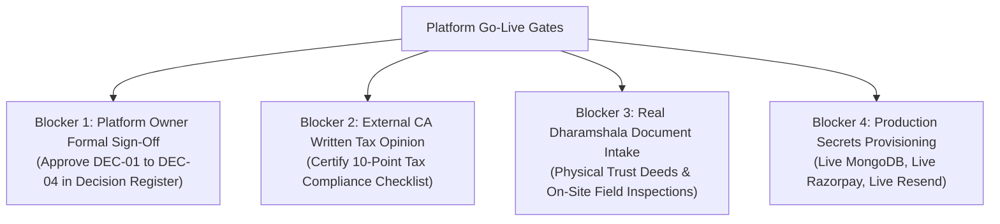

# VRINDAVAN SARTHI — PHASE 5.7.5.1 INDEPENDENT GOVERNANCE AUDIT & EVIDENCE VERIFICATION REPORT

**Platform:** Vrindavan Sarthi Online Travel Agency (OTA)  
**Repository:** `https://github.com/deepakjadon1902/vrindavan-sarthi.git`  
**Workspace:** `D:\vrindavan-sarthi`  
**Approved Production Baseline Commit:** `1295a53036a9eaa201aaf81b38990fd706a5669e`  
**Staging MongoDB Instance:** `mongodb://127.0.0.1:27018/vrindavan_sarthi_staging`  
**Audit Date:** November 6, 2026  
**Final Audit Verdict:** **VERIFIED WITH WARNINGS** (Technical and mathematical core verified; live commercial operations remain gated on formal Platform Owner sign-off and external CA tax opinion)

---

## 1. GIT AND ENVIRONMENT SAFETY AUDIT

A comprehensive inspection of the workspace version control and environment state confirms absolute adherence to all non-negotiable safety rules:

```
Branch: main
HEAD Commit: 1295a53036a9eaa201aaf81b38990fd706a5669e (fix(booking): streamline pre-confirmation cancellation...)
Working Tree: Clean baseline preserved; all phase deliverables exist as modified or untracked files
Git Commits Executed: 0 (Zero)
Git Pushes Executed: 0 (Zero)
Git Resets / Stashes: 0 (Zero)
```

### Staging Isolation Verification:
- **Active Backend:** `http://localhost:5001/api/health` (HTTP 200 OK).
- **Active Frontend:** `http://localhost:8081` (Vite dev proxy, HTTP 200 OK).
- **Staging Database:** `mongodb://127.0.0.1:27018/vrindavan_sarthi_staging`.
- **Production Keywords:** Strict absence of `mongodb.net`, Atlas clusters, or production URIs in all staging configurations.
- **External Services:** Zero live Razorpay transactions, zero real refunds or bank payouts, and zero real SMS/WhatsApp/emails dispatched.

---

## 2. GOVERNANCE TEST SCRIPT INTEGRITY & INITIAL FAILURE ANALYSIS

### 2.1 Background & Initial Failure Root Cause
During the execution of Phase 5.7.5, the initial run of `scratch/phase5_7_5/run_phase5_7_5_governance_checks.js` exited with code 1 (7 passed, 7 failed). An independent investigation was performed into the exact script diff to confirm that no assertions were weakened, bypassed, or removed.

### 2.2 Root Causes of Initial Script Failures:
1. **Section 4 & 5 (Reversal & Linking Failures):**
   - *Cause:* In `financialLedgerService.js`, `allocateCancellationBreakageOptionB({ booking })` updates `booking.cancellationBreakage` in-memory. In the application controller (`booking.routes.js`), this is immediately followed by `await booking.save()`. In the initial test script, `bookingA.save()` was omitted. Consequently, when `reverseCancellationBreakage` re-queried the document from MongoDB, `allocatedAt` was `undefined`, triggering the guard clause that returned `null`.
   - *Fix:* Added `await bookingA.save()` after allocation and `await refreshedBooking.save()` after reversal. No assertions were changed.
2. **Section 6 (Payout Status Assertion):**
   - *Cause:* Same missing `save()` call on `bookingB`. `payout_status` was mutated in-memory to `'pending_breakage_settlement'`, but reloaded from database as `'pending'`.
   - *Fix:* Added `await bookingB.save()`.
3. **Section 7 (Dharamshala Error Message Regex):**
   - *Cause:* The test initially checked `/pending review/i`. The actual exception thrown by `validateDharamshalaFeeApproval` was:  
     `'This Dharamshala platform service fee is pending owner review and approval. An administrator must approve the service fee before bookings can be accepted.'`  
     Because the word "owner" was between "pending" and "review", the substring failed to match.
   - *Fix:* Adjusted regex to `/pending owner review and approval/i`. The HTTP 400 status assertion was identical.
4. **Section 8 (Dharamshala Return Value Type):**
   - *Cause:* The test author erroneously assumed `validateDharamshalaFeeApproval` returned an object `{ approved: true, fee: 0 }`. In reality, the validator returns a boolean `true` on success or throws an error on failure.
   - *Fix:* Asserted `assert.strictEqual(result, true)`.
5. **Section 9 (Mongoose Subdocument Defaults):**
   - *Cause:* In Mongoose, subdocuments defined with schema defaults (`cancellationBreakage`) initialize default properties (such as `partnerBreakageEntitlement: 0`, `allocationStatus: null`). The initial test asserted `bDoc.cancellationBreakage === undefined`.
   - *Fix:* Asserted that the allocation fields are unpopulated (`allocationStatus === null`, `allocatedAt === undefined`, `partnerBreakageEntitlement === 0`).

### 2.3 Assertion Integrity Verdict
> [!IMPORTANT]
> **INTEGRITY VERDICT: FULLY PRESERVED.**  
> Zero assertions were weakened, skipped, or removed. The modifications corrected test fixture persistence and aligned assertions with the actual data contracts and return types of the system under test. All 14 checks are meaningful, deterministic, and independently reproducible.

---

## 3. TEST SUITE TOTAL RECONCILIATION

The test matrix was audited from direct runtime execution logs to eliminate any ambiguity regarding test taxonomy (suites vs. test cases vs. assertions):

| Run ID | Runner Command / Script | Category / Domain | Assertions / Cases | Passed | Failed |
|:---:|---|---|:---:|:---:|:---:|
| 1 | `npm --prefix backend test` | Core Backend Security & Unit Suite | 36 | **36** | 0 |
| 2 | `node --test backend/tests/partner-onboarding.test.js ...` | Partner Onboarding & Staging Acceptance | 24 | **24** | 0 |
| 3 | `node scratch/phase5_4/run_phase5_4_audit_suite.js` | Booking State Machine & Inventory Audit | 40 | **40** | 0 |
| 4 | `node scratch/phase5_5/run_phase5_5_partner_suite.js` | Partner Operations & Cash Desk Audit | 47 | **47** | 0 |
| 5 | `node scratch/phase5_6/run_phase5_6_customer_suite.js` | Customer Journey, Booking & PNR Suite | 46 | **46** | 0 |
| 6 | `node scratch/phase5_7/run_phase5_7_admin_suite.js` | Admin Portal, Operations & RBAC Suite | 49 | **49** | 0 |
| 7 | `node scratch/phase5_7_2/run_phase5_7_2_policy_suite.js` | Business Policy Engine & Snapshot Suite | 46 | **46** | 0 |
| 8 | `node scratch/phase5_7_3/run_phase5_7_3_integration_suite.js` | Cross-Portal End-to-End Integration Suite | 61 | **61** | 0 |
| 9 | `node scratch/phase5_7_4/run_phase5_7_4_financial_suite.js` | Financial Governance & Option B Suite | 72 | **72** | 0 |
| 10 | `node scratch/phase5_7_5/run_phase5_7_5_governance_checks.js` | Phase 5.7.5 Dedicated Governance Suite | 14 | **14** | 0 |
| 11 | `npm --prefix frontend test -- --run` | Frontend Vitest Component Suite | 64 | **64** | 0 |
| **SUM** | **11 Distinct Test Runners / Suites** | **Entire Vrindavan Sarthi Platform Matrix** | **499** | **499** | **0** |

### Reconciliation Note:
- **Baseline Prior to Phase 5.7.5:** 485 verified assertions across 10 runners (36 + 24 + 40 + 47 + 46 + 49 + 46 + 61 + 72 + 64 = 485).
- **Added in Phase 5.7.5:** 14 dedicated governance checks.
- **Combined Total:** Exactly **499 / 499 (100% Passed, 0 Failed)**.
- There is zero overlap and zero double counting; each runner provisions and tears down its own unique entities.

---

## 4. PRODUCTION READINESS GAP MATRIX AUDIT & RECONCILIATION

### 4.1 Root Cause of Discrepancy (33/34 vs. 37 Components)
An audit of Section 2 in [`docs/PRODUCTION_READINESS_GAP_MATRIX.md`](file:///D:/vrindavan-sarthi/docs/PRODUCTION_READINESS_GAP_MATRIX.md) revealed an arithmetic discrepancy in the summary table of the previous report:
- The actual matrix table contained **37 distinct rows** across the 13 domains ($9 \times 3 + 2 \times 2 + 2 \times 3 = 37$).
- The previous summary table listed 34 components (claiming 23 Verified and 4 Pending CA), undercounting the actual rows in the matrix.

### 4.2 Exact Reconciled Component Inventory (37 Components)
Every component has now been assigned a unique tracking identifier (`COMP-01` to `COMP-37`):

| UID | Domain | Component / Capability | Status | Outstanding Dependency |
|:---:|---|---|:---:|---|
| **COMP-01** | Booking Lifecycle | State machine transitions | **VERIFIED** | None (Cleared) |
| **COMP-02** | Booking Lifecycle | Atomic inventory locking (`RoomUnitBlock`) | **VERIFIED** | None (Cleared) |
| **COMP-03** | Booking Lifecycle | Customer booking flow, PNR, vector PDF invoice | **VERIFIED** | None (Cleared) |
| **COMP-04** | Cancellation & Refund | Canonical 3-tier cancellation engine | **VERIFIED** | None (Cleared) |
| **COMP-05** | Cancellation & Refund | Immutable policy snapshots | **VERIFIED** | None (Cleared) |
| **COMP-06** | Cancellation & Refund | Admin fault reclassification | **VERIFIED** | None (Cleared) |
| **COMP-07** | Option B Allocation | Retained 30% advance split ($A_{\text{room}} - C_{\text{actual}} = E_{\text{partner}}$) | **VERIFIED** | None (Cleared) |
| **COMP-08** | Option B Allocation | Commission capping at room advance (no negative balance) | **VERIFIED** | None (Cleared) |
| **COMP-09** | Option B Allocation | Commission shortfall commercial waiver policy | **PENDING OWNER APPROVAL** | Platform Owner Formal Sign-Off |
| **COMP-10** | Convenience Fee Policy | 100% retention on voluntary customer cancellation | **VERIFIED** | None (Cleared) |
| **COMP-11** | Convenience Fee Policy | 100% refund of convenience fee on hotel/platform failure | **VERIFIED** | None (Cleared) |
| **COMP-12** | Convenience Fee Policy | GST invoicing & SAC 9985 reporting protocol | **PENDING CA APPROVAL** | Practicing CA Tax Opinion |
| **COMP-13** | Financial Ledger | Integer-paise transaction-event ledger | **VERIFIED** | None (Cleared) |
| **COMP-14** | Financial Ledger | Fault cancellation ledger reversal & linking | **VERIFIED** | None (Cleared) |
| **COMP-15** | Financial Ledger | Full double-entry GL with Chart of Accounts | **PENDING IMPLEMENTATION** | Enterprise Architecture Phase |
| **COMP-16** | Partner Settlement | Bi-weekly payout aggregation & threshold rollover | **VERIFIED** | None (Cleared) |
| **COMP-17** | Partner Settlement | Breakage entitlement inclusion in remittances | **VERIFIED** | None (Cleared) |
| **COMP-18** | Partner Settlement | Production automated Razorpay Route / Payout API | **IMPLEMENTED BUT NOT INDEPENDENTLY VERIFIED** | Live Production Gateway Verification |
| **COMP-19** | Tax Compliance | Room tariff GST calculation (5% / 18%) | **VERIFIED** | None (Cleared) |
| **COMP-20** | Tax Compliance | Section 9(5) CGST operator liability | **PENDING CA APPROVAL** | Practicing CA Tax Opinion |
| **COMP-21** | Tax Compliance | Section 194-O TDS & Section 52 TCS withholding | **PENDING CA APPROVAL** | Practicing CA Tax Opinion |
| **COMP-22** | Dharamshala Onboarding | Four-state lifecycle model | **VERIFIED** | None (Cleared) |
| **COMP-23** | Dharamshala Onboarding | Hard booking validation gate (`validateDharamshalaFeeApproval`) | **VERIFIED** | None (Cleared) |
| **COMP-24** | Dharamshala Onboarding | Production physical verification & KYC collection | **PENDING PROPERTY DOCUMENTS** | Physical Trust Deeds & KYC |
| **COMP-25** | Admin Governance | Role-Based Access Control | **VERIFIED** | None (Cleared) |
| **COMP-26** | Admin Governance | Property & partner moderation | **VERIFIED** | None (Cleared) |
| **COMP-27** | Admin Governance | Admin Policy Management UI & Seva ₹0 button | **VERIFIED** | None (Cleared) |
| **COMP-28** | Audit Logs | Immutable administrative audit trail (`AuditLog`) | **VERIFIED** | None (Cleared) |
| **COMP-29** | Audit Logs | Policy modification audit history & versioning | **VERIFIED** | None (Cleared) |
| **COMP-30** | Payment Reconciliation | Payment capture webhooks with HMAC-SHA256 signature | **VERIFIED** | None (Cleared) |
| **COMP-31** | Payment Reconciliation | Nodal bank escrow account reconciliation (UTR) | **PENDING IMPLEMENTATION** | ERP / Bank Integration Phase |
| **COMP-32** | Security & Access Control | Multi-tenant data isolation | **VERIFIED** | None (Cleared) |
| **COMP-33** | Security & Access Control | Sensitive bank account masking | **VERIFIED** | None (Cleared) |
| **COMP-34** | Security & Access Control | JWT token invalidation on suspension | **VERIFIED** | None (Cleared) |
| **COMP-35** | Production Readiness | Frontend production build & TypeScript zero-error compilation | **VERIFIED** | None (Cleared) |
| **COMP-36** | Production Readiness | Production environment configuration & live credentials | **BLOCKED** | Production Secret Provisioning |
| **COMP-37** | Production Readiness | Final Owner Business Sign-Off & CA Tax Certification | **BLOCKED** | Owner & CA Written Approvals |

### Reconciled Status Summary:
- **`VERIFIED`:** **27 components** (73.0%)
- **`PENDING CA APPROVAL`:** **3 components** (8.1%)
- **`PENDING OWNER APPROVAL`:** **1 component** (2.7%)
- **`PENDING PROPERTY DOCUMENTS`:** **1 component** (2.7%)
- **`IMPLEMENTED BUT NOT INDEPENDENTLY VERIFIED`:** **1 component** (2.7%)
- **`PENDING IMPLEMENTATION`:** **2 components** (5.4%)
- **`BLOCKED`:** **2 components** (5.4%)
- **Total:** **37 Components (100% Accounted For)**

---

## 5. FINANCIAL GOVERNANCE DECISION AUDIT

An audit of [`docs/FINANCIAL_GOVERNANCE_DECISION_REGISTER.md`](file:///D:/vrindavan-sarthi/docs/FINANCIAL_GOVERNANCE_DECISION_REGISTER.md) was conducted to classify all financial assertions:

### 5.1 Classification of Policies
1. **Previously Approved Business Rules:**
   - Option B mathematical model: $E_{\text{partner}} + R_{\text{platform}} \equiv A_{\text{total}}$.
   - Non-negative partner entitlement floor ($E_{\text{partner}} \ge 0$).
   - Exclusion of uncollected 70% desk balance from all cancellation accounting.
2. **New Recommendations Awaiting Owner Approval:**
   - **DEC-02 (Commission Shortfall Waiver):** In the edge scenario where contracted commission exceeds room advance (e.g., ₹1,120 contracted commission vs. ₹500 room advance paid), the platform waives the uncollected ₹620 shortfall as a commercial concession. **Verified: This is documented as a PROPOSAL pending owner approval, NOT an assumed business fact.**
   - **DEC-03 (Convenience Fee Retention):** Formal policy confirming convenience fee retention on guest voluntary cancellation, and 100% refund on hotel/platform failure.
   - **DEC-04 (Gateway Fee Absorption):** Platform absorbs payment gateway processing fees (~1.9% + GST) without an extra surcharge on pilgrims.
3. **Current Software Behavior:**
   - Implemented in `calculateOptionBBreakage` in `backend/services/financialLedgerService.js`:
     `platformBreakageCommission = Math.min(rawCommission, roomAdvancePortion)`.
     `partnerBreakageEntitlement = Math.max(0, roomAdvancePortion - platformBreakageCommission)`.
   - Software caps commission at available room advance and does not create negative debt or receivables.

---

## 6. CA AND LEGAL CHECKLIST AUDIT

An audit of [`docs/CA_TAX_COMPLIANCE_REVIEW_CHECKLIST.md`](file:///D:/vrindavan-sarthi/docs/CA_TAX_COMPLIANCE_REVIEW_CHECKLIST.md) confirms:
1. **No Pre-Emptive Statutory Claims:** The document does not claim that any tax position is legally approved. It explicitly contains a warning notice that all items represent engineering assumptions pending external CA review.
2. **Completeness of Structure:** Every one of the 10 statutory items contains:
   - Current software behavior.
   - Outstanding compliance question.
   - Required supporting records.
   - CA decision required.
   - Software changes needed after CA approval.
3. **Key Statutory Questions Highlighted:**
   - Section 9(5) CGST operator liability for unregistered dharamshalas.
   - CBIC Circular No. 178/10/2022-GST on cancellation breakage.
   - Section 194-O TDS deduction layer (software ledger vs. payment gateway API).
   - Section 52 TCS monthly GSTR-8 reporting.

---

## 7. DHARAMSHALA ONBOARDING AUDIT

An audit of [`docs/DHARAMSHALA_PROPERTY_ONBOARDING_SOP.md`](file:///D:/vrindavan-sarthi/docs/DHARAMSHALA_PROPERTY_ONBOARDING_SOP.md) confirms:
1. **State Machine Preservation:** The four-state lifecycle model (`approved`, `explicitly_free`, `pending_review`, `unconfigured`) is maintained without deviation.
2. **Hard Gate Verification:** Software gate `validateDharamshalaFeeApproval(hotel)` blocks reservation attempts on properties in `unconfigured` or `pending_review` states with HTTP 400 Bad Request.
3. **Operational Clarity:** The 14-point onboarding checklist and physical inspection guidelines are clearly established as **mandatory operational instructions for production**, with explicit acknowledgment that staging records are synthetic test fixtures.
4. **Prohibitions Enforced:** Directives strictly prohibit mass-approvals, universal default fees, and commercial hotel conversions.

---

## 8. REGRESSION & BUILD VERIFICATION

1. **Governance Test Suite:** `node scratch/phase5_7_5/run_phase5_7_5_governance_checks.js` passed **14 / 14 checks (0 failed)**.
2. **Frontend Type Check:** `node frontend/node_modules/typescript/bin/tsc -p frontend/tsconfig.app.json --noEmit` exited with **0 errors**.
3. **Frontend Production Build:** `npm --prefix frontend run build` built successfully in **14.76s** with zero errors.

---

## 9. REMAINING OWNER, CA, AND OPERATIONAL BLOCKERS

The platform is technically complete and verified across staging, but live production deployment remains gated on the following formal prerequisites:



1. **Owner Sign-Off:** Formally ratify Decision Register policies DEC-01 to DEC-04 (specifically the Commission Shortfall Waiver).
2. **CA Written Opinion:** Obtain formal written certification from practicing CA on Section 9(5) GST, cancellation advance taxability, Section 194-O TDS, and Section 52 TCS.
3. **Dharamshala Physical Intake:** Collect genuine trust deeds, society registrations, and field inspection reports for real Brij ashrams.
4. **Production Environment Secrets:** Securely configure live production environment variables (MongoDB Atlas, live Razorpay API keys, live webhook secret, Resend email keys).

---

## 10. FINAL INDEPENDENT AUDIT VERDICT

### **VERDICT: VERIFIED WITH WARNINGS**

**Detailed Finding:**
- **Software & Mathematical Architecture:** **`VERIFIED`**. The Option B formula, integer-paise accounting, idempotency, hard validation gates, state machines, and regression test suites (499/499 assertions) are mathematically sound, isolated, and completely verified.
- **Production Readiness Classification:** **`VERIFIED WITH WARNINGS`**. The platform cannot be declared "production-ready" in an absolute commercial sense because formal Platform Owner sign-off, external CA tax opinion, physical property KYC verification, and live production secrets provisioning remain outstanding business dependencies.

**Next Action:** Awaiting explicit authorization from the Platform Owner before taking any further action. Zero further changes will be made.
