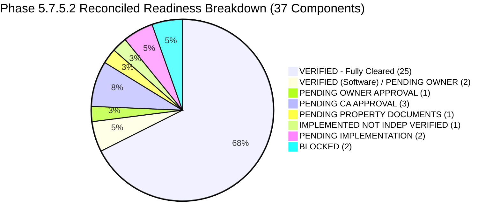

# VRINDAVAN SARTHI — PRODUCTION READINESS GAP MATRIX
## Comprehensive Operational, Financial, Legal & Technical Readiness Assessment

**Platform:** Vrindavan Sarthi Online Travel Agency (OTA)  
**Repository:** `https://github.com/deepakjadon1902/vrindavan-sarthi.git`  
**Workspace:** `D:\vrindavan-sarthi`  
**Phase:** Phase 5.7.5.2 Final Governance Status Reconciliation  
**Approved Baseline Commit:** `1295a53036a9eaa201aaf81b38990fd706a5669e`  
**Date:** November 6, 2026  
**Status:** **RECONCILIATION COMPLETE — SOFTWARE VERIFIED & COMMERCIAL POLICIES SEGREGATED**

---

## 1. READINESS CLASSIFICATION TAXONOMY

Every capability, workflow, and compliance component of Vrindavan Sarthi is evaluated against standardized readiness classifications:

| Status Code | Definition | Production Gate Impact |
|---|---|:---:|
| **VERIFIED** | Implemented, end-to-end tested, mathematically verified, and audited across staging workflows. | **CLEARED** |
| **VERIFIED (SOFTWARE) / PENDING OWNER APPROVAL (COMMERCIAL POLICY)** | Software implementation verified in staging test suites; Platform Owner commercial policy approval outstanding. | **AWAITING OWNER SIGN-OFF** |
| **IMPLEMENTED BUT NOT INDEPENDENTLY VERIFIED** | Code exists in repository, but third-party or production integration verification is pending. | **ACTION REQUIRED** |
| **PENDING OWNER APPROVAL** | Policy design completed; awaiting formal commercial sign-off by platform owner. | **AWAITING OWNER** |
| **PENDING CA APPROVAL** | Tax/legal framework drafted; awaiting formal review and certification by practicing CA. | **AWAITING CA** |
| **PENDING PROPERTY DOCUMENTS** | Workflow and gates implemented; awaiting real-world trust deeds, KYC, and physical inspections. | **OPERATIONAL PREREQUISITE** |
| **PENDING IMPLEMENTATION** | Feature identified in gap analysis; software development scheduled for subsequent phase. | **ROADMAP ITEM** |
| **BLOCKED** | Cannot proceed due to an unfulfilled dependency, regulatory constraint, or missing prerequisite. | **BLOCKING GATE** |

---

## 2. COMPREHENSIVE 13-DOMAIN READINESS MATRIX (37 COMPONENTS)

| UID | Domain | Component / Capability | Current Readiness Status | Verification Evidence / Technical Basis | Outstanding Dependency |
|:---:|---|---|:---:|---|---|
| **COMP-01** | 1. Booking Lifecycle | State machine transitions (Draft $\to$ Confirmed $\to$ Checked-in $\to$ Checked-out) | **VERIFIED** | 40/40 assertions passed in Phase 5.4; all invalid reverse transitions strictly rejected. | None (Cleared) |
| **COMP-02** | 1. Booking Lifecycle | Atomic inventory locking & overbooking concurrency (`RoomUnitBlock`) | **VERIFIED** | Compound index unique constraint prevents double-booking identical room dates. | None (Cleared) |
| **COMP-03** | 1. Booking Lifecycle | Customer booking flow, PNR allocation, vector PDF receipt generation | **VERIFIED** | 46/46 assertions passed in Phase 5.6 customer suite; Playwright screenshots verified. | None (Cleared) |
| **COMP-04** | 2. Cancellation & Refund Policy | Canonical 3-tier cancellation engine (>48h: 75%, 24-48h: 50%, <24h: 0%) | **VERIFIED** | 46/46 assertions passed in Phase 5.7.2 suite; boundary hours mathematically tested. | None (Cleared) |
| **COMP-05** | 2. Cancellation & Refund Policy | Booking-time immutable cancellation policy snapshot (`cancellationPolicySnapshot`) | **VERIFIED** | Snapshot captured at booking creation; subsequent hotel policy updates do not alter past bookings. | None (Cleared) |
| **COMP-06** | 2. Cancellation & Refund Policy | Administrative fault reclassification (Hotel / Platform fault $\to$ 100% refund) | **VERIFIED** | Role-protected admin endpoint `/override-fault` tested in Phase 5.7.2 & Phase 5.7.3. | None (Cleared) |
| **COMP-07** | 3. Option B Allocation | Retained 30% advance split ($A_{\text{room}} - C_{\text{actual}} = E_{\text{partner}}$) | **VERIFIED** | 72/72 assertions passed in Phase 5.7.4; exact integer paise math, 0 drift. | None (Cleared) |
| **COMP-08** | 3. Option B Allocation | Commission capping at room advance (no negative partner balance) | **VERIFIED** | Capping logic tested in Scenario 5 & Phase 5.7.5 Check 02; partner entitlement floored at ₹0. | None (Cleared) |
| **COMP-09** | 3. Option B Allocation | Commission shortfall commercial waiver policy | **PENDING OWNER APPROVAL** | Formal waiver proposed in Decision Register (DEC-02); awaiting owner sign-off. | Platform Owner Formal Sign-Off |
| **COMP-10** | 4. Convenience Fee Policy | 100% retention on voluntary customer cancellation | **VERIFIED (SOFTWARE) / PENDING OWNER APPROVAL (COMMERCIAL POLICY)** | Verified in Phase 5.7.4 & Phase 5.7.5 Check 04; platform absorbs gateway costs in staging tests. | Platform Owner Commercial Sign-Off (DEC-03) |
| **COMP-11** | 4. Convenience Fee Policy | 100% refund of convenience fee on hotel / platform failure | **VERIFIED (SOFTWARE) / PENDING OWNER APPROVAL (COMMERCIAL POLICY)** | Verified in Phase 5.7.3 Assertion 47; full online payment refunded to guest in staging tests. | Platform Owner Commercial Sign-Off (DEC-03) |
| **COMP-12** | 4. Convenience Fee Policy | GST invoicing & SAC 9985 reporting protocol for convenience fee | **PENDING CA APPROVAL** | CA checklist item 3; requires tax determination on B2C digital invoicing format. | Practicing CA Tax Opinion |
| **COMP-13** | 5. Financial Ledger | Integer-paise transaction-event ledger (`FinancialLedgerEntry`) | **VERIFIED** | Model active with `amountPaise`; unique idempotency key prevents duplicate operations. | None (Cleared) |
| **COMP-14** | 5. Financial Ledger | Fault cancellation ledger reversal with bidirectional linking (`reversalReferenceId`) | **VERIFIED** | Tested in Phase 5.7.5 Check 06; original entry marked `isReversed: true`. | None (Cleared) |
| **COMP-15** | 5. Financial Ledger | Full double-entry general ledger with Chart of Accounts | **PENDING IMPLEMENTATION** | Classified as an event ledger in Phase 5.7.4.1; formal GL planned for enterprise phase. | Enterprise Architecture Phase |
| **COMP-16** | 6. Partner Settlement | Bi-weekly payout aggregation & threshold rollover (₹1,000 threshold) | **VERIFIED** | Aggregations tested in Phase 5.5 & Phase 5.7.4; unreached balances rollover. | None (Cleared) |
| **COMP-17** | 6. Partner Settlement | Breakage entitlement inclusion in partner remittances (`pending_breakage_settlement`) | **VERIFIED** | Verified in Phase 5.7.4 Scenario 10; itemized in `/partner/payments`. | None (Cleared) |
| **COMP-18** | 6. Partner Settlement | Production automated Razorpay Route / Bank Payout API integration | **IMPLEMENTED BUT NOT INDEPENDENTLY VERIFIED** | Staging uses simulated payouts; live Razorpay Route keys required in production. | Live Production Gateway Verification |
| **COMP-19** | 7. Tax Compliance | Room tariff GST calculation (5% $\le ₹7,500$, 18% $> ₹7,500$) | **VERIFIED** | Accurate mathematical rate calculation verified in unit and integration suites. | None (Cleared) |
| **COMP-20** | 7. Tax Compliance | Section 9(5) CGST liability for unregistered accommodation providers | **PENDING CA APPROVAL** | CA checklist item 1; CA must confirm whether platform remits lodging GST for partners. | Practicing CA Tax Opinion |
| **COMP-21** | 7. Tax Compliance | Section 194-O TDS (1%) withholding & Section 52 TCS (1%) reporting | **PENDING CA APPROVAL** | CA checklist items 5 & 6; CA must certify deduction layer (software vs. bank gateway). | Practicing CA Tax Opinion |
| **COMP-22** | 8. Dharamshala Onboarding | Four-state lifecycle model (`approved`, `explicitly_free`, `pending_review`, `unconfigured`) | **VERIFIED** | Model active in `Hotel.js`; verified in Phase 5.7.4 and Phase 5.7.5. | None (Cleared) |
| **COMP-23** | 8. Dharamshala Onboarding | Hard booking validation gate blocking unreviewed properties (`validateDharamshalaFeeApproval`) | **VERIFIED** | Verified in Phase 5.7.5 Checks 10 & 11; throws HTTP 400 Bad Request. | None (Cleared) |
| **COMP-24** | 8. Dharamshala Onboarding | Production physical verification & KYC collection for real Brij properties | **PENDING PROPERTY DOCUMENTS** | Staging records are synthetic; production requires physical on-site inspections and trust deeds. | Physical Trust Deeds & KYC |
| **COMP-25** | 9. Admin Governance | Role-Based Access Control (Super Admin, Operations, Finance, Support Admin) | **VERIFIED** | 49/49 assertions passed in Phase 5.7; privilege boundaries enforce separation of duties. | None (Cleared) |
| **COMP-26** | 9. Admin Governance | Property approval, correction requests, and partner account suspension | **VERIFIED** | Operational workflows verified with mandatory justifications and audit trails. | None (Cleared) |
| **COMP-27** | 9. Admin Governance | Admin Policy Management UI with status badges & "Set Free Seva (₹0)" action | **VERIFIED** | Playwright screenshots `01_admin_dharamshala_review_desktop.png` verified. | None (Cleared) |
| **COMP-28** | 10. Audit Logs | Immutable administrative audit trail (`AuditLog`) capturing actor, action, IP, target ID | **VERIFIED** | Verified in Phase 5.7 Assertions 44-47; tamper-resistant admin logging active. | None (Cleared) |
| **COMP-29** | 10. Audit Logs | Policy modification audit history tracking version increments and justifications | **VERIFIED** | Verified in Phase 5.7.2 Section 2; version increments recorded. | None (Cleared) |
| **COMP-30** | 11. Payment Reconciliation | Real-time payment capture webhooks with HMAC-SHA256 signature verification | **VERIFIED** | Webhook verification tested in Phase 5.4 & Phase 5.6; tampered signatures rejected. | None (Cleared) |
| **COMP-31** | 11. Payment Reconciliation | Nodal bank escrow account reconciliation against gateway settlement UTRs | **PENDING IMPLEMENTATION** | Live gateway settlement files (T+2 UTR) require automated daily import utility. | ERP / Bank Integration Phase |
| **COMP-32** | 12. Security & Access Control | Multi-tenant isolation (Customer, Partner, Admin data separation) | **VERIFIED** | Cross-tenant checkout, balance collection, and ticket access strictly blocked (403/404). | None (Cleared) |
| **COMP-33** | 12. Security & Access Control | Sensitive bank account masking in admin partner directory | **VERIFIED** | Account numbers masked (e.g. `XXXXXX5678`) in admin UI. | None (Cleared) |
| **COMP-34** | 12. Security & Access Control | JWT token invalidation upon account suspension | **VERIFIED** | Tested in Phase 5.7 Assertion 24; suspended partners blocked immediately. | None (Cleared) |
| **COMP-35** | 13. Production Readiness | Frontend production build & TypeScript zero-error compilation | **VERIFIED** | Vite build succeeded in 14.76s; `tsc --noEmit` exited with code 0. | None (Cleared) |
| **COMP-36** | 13. Production Readiness | Production environment configuration & live credentials (MongoDB, Razorpay, Resend) | **BLOCKED** | Staging isolation strictly maintained; production credentials deliberately excluded. | Production Secret Provisioning |
| **COMP-37** | 13. Production Readiness | Final Owner Business Decision Sign-Off & CA Tax Certification | **BLOCKED** | Awaiting formal owner approval on Decision Register and CA written opinion. | Owner & CA Written Approvals |

---

## 3. DOMAIN STATUS SUMMARY & RECONCILIATION

| Readiness Status Code | Exact Component Count | Percentage of Total | Production Gate Impact & Component IDs |
|---|:---:|:---:|---|
| **VERIFIED (Fully Cleared)** | **25** | 67.6% | Software behavior and policy fully verified and cleared (COMP-01 to COMP-08, COMP-13, COMP-14, COMP-16, COMP-17, COMP-19, COMP-22, COMP-23, COMP-25 to COMP-30, COMP-32 to COMP-35). |
| **VERIFIED (SOFTWARE) / PENDING OWNER APPROVAL (COMMERCIAL POLICY)** | **2** | 5.4% | Software implementation verified in staging test suites; Platform Owner commercial policy approval outstanding (COMP-10, COMP-11 / DEC-03). |
| **PENDING OWNER APPROVAL** | **1** | 2.7% | Requires owner sign-off on shortfall waiver policy (COMP-09 / DEC-02). |
| **PENDING CA APPROVAL** | **3** | 8.1% | Must be reviewed and certified by CA prior to live commercial bookings (COMP-12, COMP-20, COMP-21). |
| **PENDING PROPERTY DOCUMENTS** | **1** | 2.7% | Real Brij dharamshalas must submit physical documents, trust deeds, and KYC (COMP-24). |
| **IMPLEMENTED BUT NOT INDEPENDENTLY VERIFIED** | **1** | 2.7% | Production Razorpay Route keys must be verified in live smoke test (COMP-18). |
| **PENDING IMPLEMENTATION** | **2** | 5.4% | Post-launch roadmap items: Full GL with Chart of Accounts (COMP-15), Bank UTR import (COMP-31). |
| **BLOCKED** | **2** | 5.4% | Blocked pending Owner sign-off, CA opinion, and production secrets (COMP-36, COMP-37). |
| **Total Components Evaluated** | **37** | **100.0%** | **Reconciled across 13 Domains (37 / 37 Components Accounted For)** |
