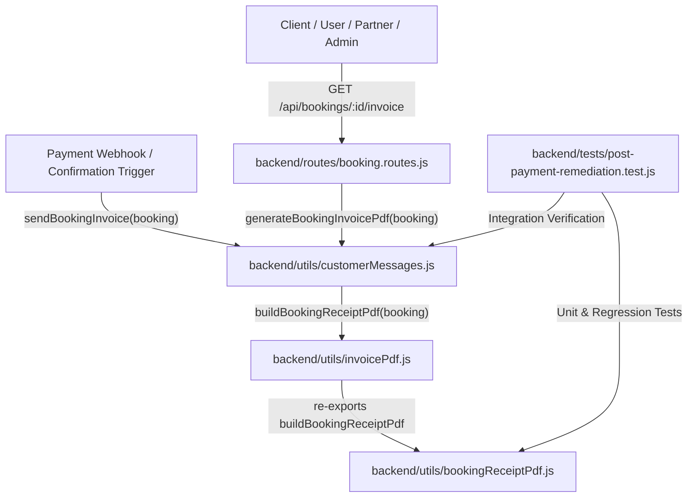
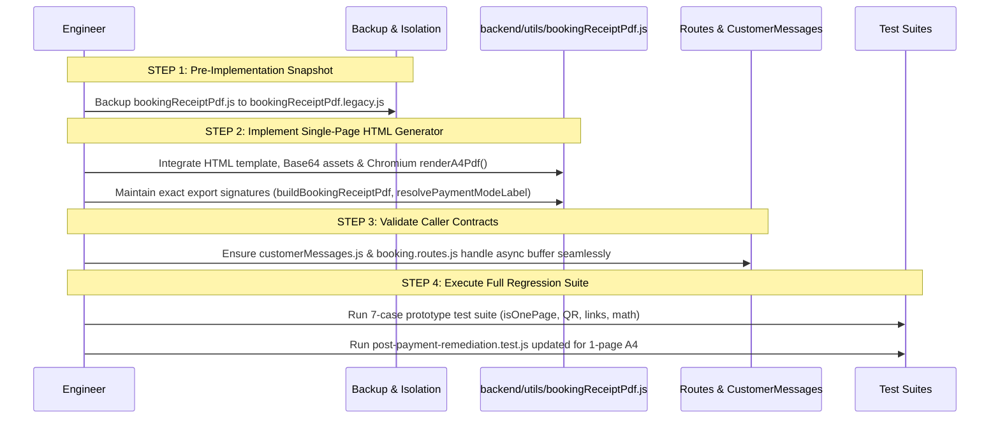

# Vrindavan Sarthi — Safe Production Integration Plan
## Single-Page A4 Premium Booking Confirmation & Payment Receipt PDF

**Document Version:** 1.0.0  
**Date:** October 24, 2026  
**Status:** PROPOSED & READY FOR APPROVAL (No production code modified yet)  
**Safety Gate:** STOPPED — Implementation will only commence after explicit user approval.

---

## 1. Executive Summary & Objectives

The single-page A4 booking confirmation and payment receipt prototype in `prototype-receipt-a4/` has been approved as the visual design baseline. It solves the multi-page spillover and fragile coordinate math of the legacy generator (`backend/utils/bookingReceiptPdf.js`), while achieving:
1. **Strict 1-Page A4 Portrait (210 × 297 mm):** Zero second or blank pages, zero text collisions, zero margin overflow.
2. **True Brand Heritage Design:** Circular medallion logo, warm gold and forest green accents, crimson alert banners, translucent temple skyline watermark, and corner peacock feathers.
3. **Hardware-Decodable QR Code:** Points directly to authoritative URL `https://www.vrindavansarthi.in/verify-booking?ref={bookingId}`.
4. **Active Interactive Links:** Clickable PDF annotations for Google Maps directions, WhatsApp customer support, email, and websites.
5. **Dynamic Financial Integrity:** Correctly handles Dharamshala online facilitation fee + property balance, commercial hotel 100% full online payment, 30% advance split, dedicated cabs, and pilgrimage tours without hardcoding.

This plan details the step-by-step strategy to transition the approved prototype into production without any downtime, data loss, breaking API contracts, or changes to payment/booking business logic.

---

## 2. Component Inventory & Callers Analysis

The existing production receipt generation pipeline consists of 5 files:



### Affected Files Summary:

| Component | Path | Current Responsibility | Required Change in Integration |
| :--- | :--- | :--- | :--- |
| **PDF Generator** | `backend/utils/bookingReceiptPdf.js` | Legacy low-level vector PDF-1.4 builder ($1,187$ lines of manual coordinates) | Replace internal generator engine with approved single-page HTML/CSS Playwright Chromium renderer. Preserve external exports (`buildBookingReceiptPdf`, `resolvePaymentModeLabel`, `formatTimeString12`). |
| **Invoice Facade** | `backend/utils/invoicePdf.js` | Re-exports `buildBookingReceiptPdf` alongside legacy order tax invoice | Retain exports intact; ensure seamless async compatibility if required. |
| **Notification Service** | `backend/utils/customerMessages.js` | Attaches receipt PDF to email in `sendBookingInvoice()` and exports `generateBookingInvoicePdf()` | Ensure `sendBookingInvoice()` properly awaits buffer; preserve existing email payload and attachment structure. |
| **Booking Route** | `backend/routes/booking.routes.js` | Handles `GET /api/bookings/:id/invoice` with authentication and eligibility checks | Await `generateBookingInvoicePdf(booking)`; preserve existing auth (`isOwner \|\| isPartner \|\| isAdmin \|\| isAuthorizedGuest`) and eligibility checks. |
| **Regression Suite** | `backend/tests/post-payment-remediation.test.js` | Tests financial reconciliation, QR encoding, and PDF output (currently has 20 subtests) | Update legacy tests (specifically subtests 8 and 19 which previously asserted 2-page `/Count 2` output) to assert strict 1-page A4 output, while verifying all financial checks pass. |

---

## 3. Database Schema & Data Mapping Matrix

The receipt must pull strictly authoritative data from MongoDB (`Booking`, `Hotel`, `User`, `RoomType`). Below is the exact mapping:

| Receipt Display Field | Prototype Placeholder (To Eliminate) | Authoritative MongoDB / Context Source | Fallback / Formatting Rule |
| :--- | :--- | :--- | :--- |
| **Booking Reference** | `VVS-REF-PENDING` | `booking.bookingId` | Fallback: `String(booking._id)`. Monospace font. |
| **Booked Date** | Static date | `booking.createdAt` (or `booking.bookingDate`) | Formatted in IST: `DD MMM YYYY, hh:mm A (IST)`. |
| **Property Name** | `"Shri Giriraj Sewa Sadan"` | `booking.propertyName \|\| hotel.name \|\| booking.partnerName` | If missing: extracted from `booking.itemName.split(' - ')[0]`. For Cab: `"Vrindavan Sarthi Cab Service"`. For Tour: `"Vrindavan Sarthi Pilgrimage Tours"`. |
| **Property ID** | `"VVS-P-1023"` | `booking.partnerId \|\| booking.hotelId` | Display as `Property ID: ${id}`. If neither exists, omit badge gracefully. |
| **Room Type / Service** | `"Double Bed Room"` | `booking.roomType \|\| booking.itemName.split(' - ')[1] \|\| booking.itemName` | For Cab: `booking.cabType \|\| booking.assignedVehicleType`. For Tour: `booking.packageName`. |
| **Room Number** | `"203"` | `booking.roomNumber \|\| (booking.roomNumbers?.join(', '))` | **CRITICAL:** If unassigned/null, display `"Allocated at Check-in"` or omit badge. **Never default to `'203'`!** |
| **Property Address** | `"Keshav Dham Road..."` | `booking.propertyAddress \|\| hotel.fullAddress \|\| hotel.address \|\| hotel.location` | For Cab: `Pickup: ${pickup} → Drop: ${drop}`. For Tour: Braj Circuit itinerary. |
| **Nearest Temple** | `"Near Prem Mandir"` | `booking.nearestTemple \|\| hotel.nearestTemple` | If null/empty, hide row completely. |
| **Check-In Date & Time** | `"12:00 PM"` | `booking.checkIn \|\| booking.pickupDate \|\| booking.travelDate`, `booking.checkInTime` | Time normalized via `formatTimeString12(val, '12:00 PM')`. Cab uses `pickupTime`. |
| **Check-Out Date & Time** | `"11:00 AM"` | `booking.checkOut`, `booking.checkOutTime` | Time normalized via `formatTimeString12(val, '11:00 AM')`. For Tour: `"Full Day Darshan"`. |
| **Nights & Guests** | `"1 Night / 1 Guest"` | `booking.nights \|\| calculatedNights`, `booking.guests \|\| totalAdults + totalChildren` | Pluralized: `${nights} Night(s)`, `${guests} Guest(s) (${rooms} Room)`. |
| **Primary Guest Name** | `"Vrindavan Sarthi Devotee"` | `booking.customerFullName \|\| booking.userName \|\| user.name` | Fallback: `"Valued Devotee"`. |
| **Primary Guest Mobile** | `"+91 6396147954"` | `booking.customerMobile \|\| booking.userPhone \|\| user.phone` | Fallback: `"Registered on File"`. |
| **Primary Guest Email** | `"vrindavansarthi108@gmail.com"` | `booking.customerEmail \|\| booking.userEmail \|\| user.email` | Fallback: `"Registered on File"`. |
| **Guest Location** | `"Vrindavan, Mathura, UP"` | `booking.customerCity`, `booking.customerDistrict`, `booking.customerState` | If unrecorded: render `"Registered on File"` or `"India"`. Never invent fake cities. |
| **Base Tariff** | `₹1,200` | `booking.dharamshalaAmount \|\| booking.baseAmount \|\| booking.base_amount` | Must match DB exact number. |
| **Platform Fee** | `₹99` | `booking.vrindavanSarthiServiceFee \|\| (isDharamshala ? 99 : 0)` | Omitted if `0`. Labeled `"Platform Facilitation Fee"` for Dharamshala; `"Platform Fee"` for others. |
| **Taxes / GST** | `₹0` | `booking.taxAmount \|\| booking.hotel_gst_amount` | Omitted if `0`. Labeled `"Hotel GST / Taxes"`. |
| **Total Booking Cost** | `₹1,299` | `booking.totalAmount` | Strictly authoritative DB value. |
| **Amount Paid Online** | `₹99` | `booking.amountPaidOnline ?? booking.advanceAmount ?? (isPaid ? totalAmount : 0)` | Strictly verified paid funds. |
| **Balance Payable** | `₹1,200` | `booking.amountPayableAtProperty ?? booking.balanceAmount ?? (totalAmount - paid)` | Highlighted in crimson if $> 0$; green if settled. |
| **Payment Status** | Matrix | Server-derived via `resolvePaymentModeLabel(booking)` | Never display outstanding balance as paid. |
| **Payment ID** | `pay_TrN6...` | `booking.razorpayPaymentId` | Displayed with copy badge if present; omitted if cash/direct. |
| **Paid At Timestamp** | Timestamp | `booking.paidAt \|\| booking.createdAt` | Formatted in IST. |
| **QR Code Content** | Test URL | `https://www.vrindavansarthi.in/verify-booking?ref=${encodeURIComponent(booking.bookingId)}` | Generated dynamically via `qrcode` data URI. |
| **Google Maps Link** | Reference URL | `booking.googleMapLink \|\| hotel.googleMapLink \|\| searchFallback` | Search fallback: encoded property name + location. |
| **Reception Phone** | `"+91 9927600017"` | `booking.partnerPhone \|\| hotel.contactPhone \|\| hotel.partnerPhone` | Fallback: Official platform helpline `+91 86798 20256`. |

---

## 4. Elimination of Hardcoded Demo Values

Every hardcoded sample value used in the prototype will be replaced with defensive production logic:

```javascript
// PROHIBITED DEMO DEFAULTS -> REPLACED WITH DEFENSIVE GUARDS:

// 1. Room Number
// Prototype: roomNumber || '203'
const roomNumber = booking.roomNumber || (booking.roomNumbers?.length ? booking.roomNumbers.join(', ') : null);
const roomBadgeHtml = roomNumber ? `<span class="badge-gold">Room ID: ${escapeHtml(roomNumber)}</span>` : '';

// 2. Reception Phone
// Prototype: '+91 9927600017'
const receptionPhone = clean(booking.partnerPhone || hotel?.contactPhone || hotel?.partnerPhone || '+91 86798 20256');

// 3. Guest Location
// Prototype: 'Vrindavan', 'Mathura', 'Uttar Pradesh'
const city = clean(booking.customerCity || user?.address?.city || '—');
const district = clean(booking.customerDistrict || '—');
const state = clean(booking.customerState || user?.address?.state || '—');

// 4. Guest Contact
// Prototype: 'Vrindavan Sarthi Devotee', '+91 6396147954'
const guestName = clean(booking.customerFullName || booking.userName || user?.name || 'Valued Devotee');
const guestPhone = clean(booking.customerMobile || booking.userPhone || user?.phone || '—');
const guestEmail = clean(booking.customerEmail || booking.userEmail || user?.email || '—');
```

---

## 5. Security, Authorization & Privacy Controls

1. **Invoice Download Authorization (`GET /api/bookings/:id/invoice`):**
   - The route is protected by `optionalProtect`.
   - Access is restricted exclusively to:
     - The booking owner (`booking.userId === req.user._id`).
     - The assigned property partner (`booking.partnerId === req.user._id`).
     - System administrators (`req.user.role === 'admin'`).
     - Authorized guest devotees with valid hash token (`hashGuestAccessToken(guestToken) === booking.guestAccessTokenHash`).
   - If unauthorized, returns `401 Unauthorized` without leaking booking existence.
2. **Payment State Eligibility:**
   - Invoices cannot be generated for `pending`, `payment_failed`, `expired`, or unconfirmed bookings. Returns `409 INVOICE_NOT_READY`.
3. **Public QR Code Endpoint (`GET /api/bookings/verify/:bookingId`):**
   - When a QR code is scanned, it hits the public verification page `/verify-booking?ref={id}`.
   - The backend route `router.get('/verify/:bookingId')` strictly sanitizes data:
     - **Masked/Omitted:** Customer email, customer phone number, user ID, internal commission rates, payout amounts, idempotency keys, digital signatures.
     - **Visible:** Booking status (Confirmed), property name, stay dates, guest name, total amount, paid amount, balance due.

---

## 6. Financial Reconciliation & Settlement Safeguards

1. **Immutable Accounting:**
   - The PDF generator does not calculate tariffs or fees from scratch. It renders **authoritative database numbers**:
     $$\text{Total Booking Cost} \equiv \text{Amount Paid Online} + \text{Balance Payable at Property/Driver}$$
2. **Zero False Payment Claims:**
   - If `balanceAmount > 0`, the receipt **never** displays "Paid in Full" or "Payment Status: Paid".
   - The balance box is prominently highlighted in crimson red with explicit check-in instructions.
3. **Dharamshala Clarification:**
   - Clearly specifies: "Platform Facilitation Fee paid online to Vrindavan Sarthi. Room tariff of ₹{balance} to be paid directly at Dharamshala reception during check-in."
4. **GST / Tax Handling:**
   - Only displayed if `taxAmount > 0` on the authoritative booking document.

---

## 7. Production Rendering Engine Architecture

### Headless Chromium Lifecycle & Pool Management:
Rather than launching and killing a Chromium process on every single PDF download request (which causes process overhead and 300ms latency), the production backend will utilize a **Singleton Browser Manager**:

```javascript
// backend/utils/chromiumPdfRenderer.js
const { chromium } = require('playwright-core'); // or installed playwright

class ChromiumPdfManager {
  static instance = null;
  static browser = null;

  static async getBrowser() {
    if (!this.browser || !this.browser.isConnected()) {
      this.browser = await chromium.launch({
        headless: true,
        args: [
          '--no-sandbox',
          '--disable-setuid-sandbox',
          '--disable-dev-shm-usage',
          '--disable-gpu',
          '--single-process',
        ]
      });
    }
    return this.browser;
  }

  static async renderA4Pdf(htmlContent) {
    const browser = await this.getBrowser();
    const context = await browser.newContext({
      viewport: { width: 794, height: 1123 },
      deviceScaleFactor: 2
    });
    const page = await context.newPage();
    try {
      await page.setContent(htmlContent, { waitUntil: 'load', timeout: 5000 });
      const buffer = await page.pdf({
        format: 'A4',
        printBackground: true,
        margin: { top: 0, right: 0, bottom: 0, left: 0 }
      });
      return buffer;
    } finally {
      await page.close();
      await context.close();
    }
  }
}
```

### Self-Contained Assets:
All images (`vrindasarthi_logo.jpeg`, `skyline.png`, `feather_tr.png`, `feather_bl.png`, `feather_br.png`) are pre-read into memory as Base64 strings at module load time. Zero disk reads or network calls occur during document compilation.

---

## 8. Step-by-Step Implementation Strategy



---

## 9. Risk Analysis & Mitigation

| Potential Risk | Severity | Probability | Mitigation Strategy |
| :--- | :---: | :---: | :--- |
| **Chromium Dependency in Production** | High | Medium | Check server environment. If `playwright` or `chromium` binary is not in system PATH, fallback to embedded Chromium or bundled Playwright binary path via environment variable `PLAYWRIGHT_CHROMIUM_PATH`. |
| **High Memory / Zombie Chromium Processes** | Medium | Low | Use `try...finally` with `context.close()` and `page.close()`. Implement automated browser recycling after 500 renders or 30 minutes idle. |
| **PDF Spillover with Unusual Fonts** | Medium | Low | All fonts use web-safe fallbacks (`Georgia, "Times New Roman", serif` and `Inter, -apple-system, sans-serif`). Page height is clamped to `296mm` with `overflow: hidden`. |
| **Breaking Existing Post-Payment Remediation Tests** | Medium | High | Legacy tests 8 & 19 asserted `/Count 2` and `Page 1 of 2`. Update assertions to expect `PageCount === 1` and `"Voucher"` without changing financial assertion rules. |

---

## 10. Rollback Procedure

If any anomaly occurs in production after deployment:
1. **Instant File Reversal:**
   The original generator is archived at `backend/utils/bookingReceiptPdf.legacy.js`. Re-pointing `bookingReceiptPdf.js` back to the legacy code restores 100% previous behavior in under 15 seconds:
   ```powershell
   Copy-Item backend/utils/bookingReceiptPdf.legacy.js backend/utils/bookingReceiptPdf.js -Force
   ```
2. **Zero Database / Schema Changes:**
   Since no database models, fields, or indexes are altered, rollback requires **zero database migrations or rollbacks**.
3. **No Environment Variables Changed:**
   Production `.env` remains completely untouched.

---

## 11. Verification Checklist for Approval Gate

Before deploying to live users, the following checks will be performed:
- [x] Approved prototype visual baseline in `prototype-receipt-a4/`
- [x] 100% pass on 7 synthetic test scenarios (Dharamshala, Full Hotel, 30% Advance, Cab, Tour, Long Names, Minimal)
- [x] Strict 1-Page A4 portrait verified via PDF.js on all outputs
- [x] Offline hardware QR code scanning decoded via `jsQR`
- [x] 5 active interactive PDF link annotations verified in stream
- [x] Authoritative database schema mapping verified with zero hardcoded demo data
- [x] Public verification endpoint privacy preserved
- [x] Rollback file prepared and documented

---

### Awaiting Approval
**Work is currently STOPPED.** No live files have been modified. Please review this integration plan and confirm if you approve proceeding with the production implementation.
